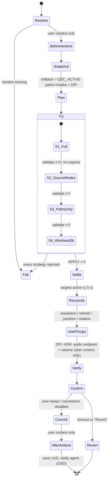
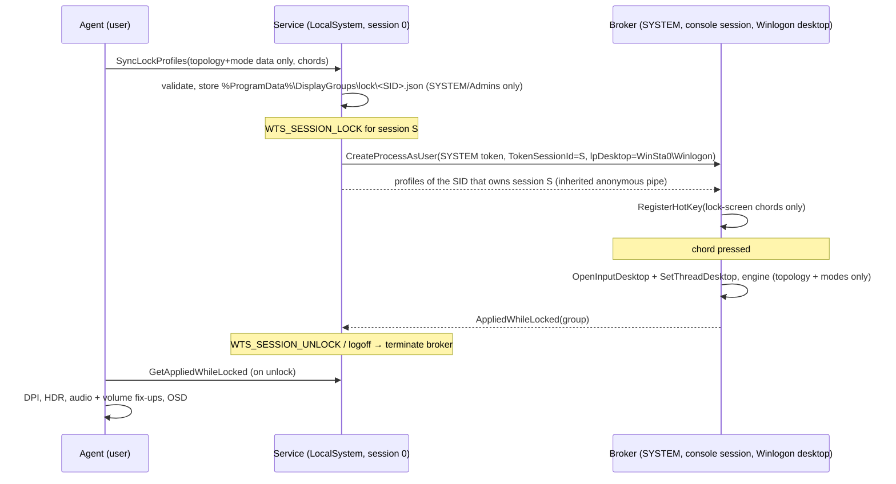

# DisplayGroups — Architecture

> Status: **Approved for v1.0** (Phase 1 sign-off 2026-11-19). **Phase 2 (core engine + CLI) done**:
> 68 automated tests pass. Read-only commands were checked on the test machine: `status`,
> `capture`, `list` and `validate`. Real switching (`apply`, `toggle`, `recover`) has not been run
> on hardware yet; per D3 that happens on a VM or secondary PC.
>
> **Phase 3 in progress.**
> - **Done:**
>   - `dg-hotkey`: chord parsing and the reserved/known-conflict tables.
>   - The agent: hotkeys with a live conflict probe, the OSD, config hot reload, the disconnect
>     fallback and single-instance.
>   - `dg-ipc`: protocol, framing and the secured pipe with caller identity.
>   - The §8.5 spike tool.
>   - 86 automated tests pass.
> - **Checked on the test machine in `--dry-run`, displays unchanged:**
>   - hotkey → OSD → fade-out;
>   - the switch broadcast → OSD;
>   - conflict detection, which reported `Ctrl+Alt+F12` as held by the old PowerShell agent;
>   - live reload, single instance and clean shutdown.
> - **Waiting on the §8.5 spike result:** the lock-screen service and broker.
>
> **Phase 4a (native parts) done**, 95 automated tests:
> - **Tray icon and menu:**
>   - Contents: groups with the current one checked, Recover, Settings…, Start with Windows,
>     Start minimized and Exit.
>   - It is re-added when Explorer restarts.
> - **"Keep these display settings?" countdown dialog:**
>   - An owner-painted Win32 window that follows the theme and works from the keyboard.
>   - Revert has the initial focus.
>   - It replaces the message box.
> - **Built-in icons** are generated at run time from Segoe Fluent Icons glyphs as multi-size
>   `.ico` files; custom `.ico`/`.png` can be imported.
> - **`shortcut` command:** `IShellLinkW` with known-folder paths for the Desktop and
>   `Start Menu\Programs\DisplayGroups`.
> - **`startup` and `protocol` commands:** both write to HKCU only.
> - **Application manifest** embedded in both binaries: common controls v6, PerMonitorV2, UTF-8.
> - **`locales/en.json`:** shared UI strings for the native parts and the settings app.
>
> Checked on the test machine, displays unchanged:
> - The dialog and the OSD were captured in dark and light themes and reviewed.
> - Icons were reviewed at 16–256 px.
> - Shortcuts with Arabic names were written to a temporary folder.
> - The tray icon was registered. A simulated right-click reached the menu code, but a menu
>   only appears for a real click, because Explorer grants foreground rights only then.
>
> **Phase 4b (settings app) done:** `apps/settings`, Tauri v2 + TypeScript + Vite, ~50 KB of JS.
> - **Groups:**
>   - List with drag reorder, duplicate, and delete with undo.
>   - Editor with the 2D canvas: drag with 8 px edge snapping, primary kept at (0,0), overlaps refused.
>   - Per-display settings. Resolution and refresh pickers come from the modes the monitor
>     really offers when it is on.
>   - Sound, actions, capture, validate and test.
> - **Hotkeys:** recording and a live availability check against other programs.
> - **Other pages:** Shortcuts, Settings and Diagnostics (with import/export).
> - **Theme:** System/Dark/Light, kept in step with the native title bar and Mica.
> - **Start, motion and text:**
>   - No white flash on start (hidden window, then fade-in).
>   - Animations use only transform/opacity and respect reduced motion.
>   - All strings come from `locales/en.json`, with RTL-safe CSS.
> - **How it works:**
>   - Config editing, validation, display status and modes, and the hotkey probe run in-process.
>   - Capture, validate, shortcut, startup, protocol and test-apply run the CLI next to the app,
>     so there is one implementation.
> - **Checked on the test machine, displays unchanged:**
>   - Each page was captured and reviewed in dark and light.
>   - The TV's real modes (3840×2160 at 120 Hz) appeared as pickers.
>   - The hotkey check correctly reported `Ctrl+Alt+F12` as held by another program.
>   - "Discard" restores the theme.
>   - Closing the window ends the process and all its WebView2 processes.
> - **Design change:** the UI uses hand-written Fluent-style CSS instead of Fluent UI Web
>   Components. It is lighter, has no runtime UI dependency, and gives full control over RTL.
> - **Left for Phase 6, now done:** "Identify", picking a custom icon file in the UI, and a
>   second language (Arabic).
>
> **v1.1, automatic switching (§15.1) done:**
> - **Pieces:**
>   - Schema and validation (`triggers`).
>   - The decision state machine in `dg-engine::triggers` (10 tests).
>   - `dg-win::detect` for programs, window titles and controllers.
>   - Agent wiring (2 s program poll; controller check after device changes).
>   - The "Automatic switching" page, in English and Arabic.
> - **Cost, measured:** a process snapshot takes ~7 ms, the controller check ~2 ms.
> - **Checked on the test machine in `--dry-run`, displays unchanged:**
>   - A `ping.exe` trigger switched (OSD) within one poll of starting.
>   - It switched back 6 s after the program ended, with a 3 s delay.
> - **Not tried yet:** a real controller connecting.
> - **Next in v1.1:** window positions (§15.2), DDC/CI (§15.3), the update notice (§15.4).
>
> **Phase 6 (completing v1.0) done:**
> - **Identify:**
>   - `displaygroups identify` and a button in the editor.
>   - The number on each screen matches the editor canvas (§9).
> - **Custom group icons:** chosen from the UI with the native Open dialog, imported as `.ico`.
> - **Languages:**
>   - Arabic translation.
>   - `"system"` language, the new default, which follows the Windows display language.
>   - Right-to-left layout in the native parts: a mirrored countdown dialog, an RTL tray menu
>     (`TPM_LAYOUTRTL`), and the OSD and Identify with RTL reading order. Technical values
>     ("3840 × 2160 · 120 Hz") stay left to right.
>   - The agent reloads strings when the language setting changes.
> - **Checks:** 105 automated tests, including translation checks.
> - **Seen on the test machine, displays unchanged:**
>   - Identify panels on both screens at 100% and 150%.
>   - The Arabic OSD and dialog in dark and light.
>   - Every settings page in Arabic.
>   - The custom-icon dialog, opened and cancelled.
> - **Not seen yet:** the RTL tray menu, which needs a real click.
>
> **Phase 5 (packaging and release) done.** §13 has the details.
> - **Installer:** Tauri's NSIS bundler, per-machine, with DisplayGroups hooks.
> - **Portable ZIP**, plus `SHA256SUMS.txt`.
> - **Scripts:** `scripts/build.ps1` and `scripts/sign.ps1`.
> - **`release.yml`:** tag → tests → package → SignPath signing in rounds → checks every
>   signature → draft release.
> - **Version resources and icons** on all three executables.
> - **Docs:** README, CONTRIBUTING, SECURITY and `docs/releasing.md`.
> - **Checked on the test machine, nothing installed:**
>   - Both packages were built and inspected: ZIP entries, the generated NSIS script and the
>     hooks compiled without warnings.
>   - The uninstaller is byte-reproducible across builds.
>   - A simulated signing round swapped and queued the right files.
> - **Not done yet:**
>   - Running the installer. It changes the system, so it waits for the VM checklist in
>     `docs/releasing.md`.
>   - The lock-screen service is not in the installer while the §8.5 spike is pending.
>
> Items marked **[VERIFIED]** were observed on real hardware (Windows 11 26H2 build 26300, RTX 5080,
> ASUS XG32UCWMG + DFI27280 + Samsung 65" TV over HDMI) while building the PowerShell prototype this
> project replaces. Items marked **[SPIKE]** are unproven and get a go/no-go test before code depends on them.

---

## 0. Decision log

| # | Decision | Status |
|---|---|---|
| D1 | Rust Cargo workspace (`windows-rs`) for engine, CLI, tray agent and optional service; Tauri v2 for an on-demand settings UI that exits completely on close | Approved |
| D2 | Product name **DisplayGroups**: binaries `displaygroups*.exe`, config `%APPDATA%\DisplayGroups\`, pipe/mutex names `DisplayGroups.*`, URI scheme `displaygroups://` | Approved |
| D3 | Smart App Control stays **on** on the dev PC. Logic is tested through unit and mock-backend tests, on GitHub Actions `windows-latest` if SAC blocks local test binaries. Real-hardware testing of unsigned builds, including the §8.5 spike, happens on a Windows 11 VM or secondary PC with SAC off. Public releases target **SignPath Foundation** through `scripts/sign.ps1` | Approved |
| D4 | Toolchain: rustup (stable MSVC), Visual Studio Build Tools 2022 (C++ workload + Windows SDK) and Git. Node.js LTS is installed when Phase 4 starts, because Phases 2–3 don't need it | Approved |
| D5 | Public repository on GitHub ([17MaDh/DisplayGroups](https://github.com/17MaDh/DisplayGroups)), MIT license | Approved |
| D6 | v1.0 additions: theme switcher, flash-free launch, motion, i18n/RTL readiness, OSD, Duplicate Group, per-group volume, pre/post-switch actions, `displaygroups://` URI, disconnect auto-fallback | Approved (§9–§11) |
| D7 | Deferred to v1.1: window-position restore, automatic triggers, DDC/CI brightness, auto-updater | Planned in §15 |
| D8 | v1.1 choices (2026-11-19). **Order:** automatic switching first, then window positions, DDC/CI, and the update notice last. **Triggers:** a program starting (switch back when it ends) and a game controller connecting. **Windows:** saved automatically per group. **Updates:** notice only, off by default; never downloads or installs | Approved (§15); §15.1 done |
| D9 | Linux (2026-11-19). **Scope:** a full port to Ubuntu GNOME (Wayland and X11) through Mutter's DisplayConfig D-Bus API, in phases L1–L4. **Build:** WSL Ubuntu 24.04 on the development PC. **Test:** an Ubuntu GNOME VM | Approved (§16); L1–L3 done |

---

## 1. Tech stack

**Rust for everything that runs in the background, plus Tauri v2 for the settings window only, started on demand.**

| Criterion | Rust + Tauri v2 | C# .NET 8/9 (rejected) |
|---|---|---|
| Background RAM (tray agent) | ~3–8 MB, pure Win32, no runtime | ~15–30 MB NativeAOT; WPF cannot be NativeAOT-compiled |
| Win32 / CCD access | `windows-rs` (Microsoft-maintained), structs generated from Win32 metadata | CsWin32, equally complete |
| Windows Service | `windows-service` crate, small static binary | Worker Service, larger |
| GUI | WebView2 (preinstalled on Win11), Fluent UI Web Components, easy 2D canvas | WPF-UI is native-looking but heavier and not AOT |
| Distribution | Static `.exe` files, no runtime | Self-contained ≈ 70–150 MB, or a runtime dependency |

The RAM budget can only be met by keeping the GUI out of the always-running process. The background
is a pure-Win32 Rust agent, including the OSD (§10). The settings UI is a separate process, so
WebView2's ~80–150 MB is only paid while the user is configuring.

---

## 2. Process model

```mermaid
flowchart LR
  subgraph User session (console)
    A[displaygroupsw.exe agent\ntray, hotkeys, OSD,\ndisconnect fallback]
    U[displaygroups-settings.exe\nTauri, on demand]
    C[displaygroups.exe\nCLI, console]
    W[displaygroupsw.exe apply / uri ...\nshortcuts + displaygroups:// , no console]
    B[displaygroups-svc.exe broker\nSYSTEM token, Winlogon desktop\nonly while locked]
  end
  subgraph Session 0
    S[displaygroups-svc.exe\nWindows Service, LocalSystem\noptional, installer-only]
  end
  U -- edits --> CFG[(%APPDATA%\\DisplayGroups\\config.json)]
  A -- watches --> CFG
  C & W & A & U -- link --> E[dg-engine]
  A <-- named pipe --> S
  S -- spawns on lock / kills on unlock --> B
  S <-- inherited anonymous pipe --> B
```

| Binary | Subsystem | Runs as | Lifetime | Purpose |
|---|---|---|---|---|
| `displaygroups.exe` | console | user | per command | CLI for terminals and scripts |
| `displaygroupsw.exe` | windows | user | per command, or `agent` (resident) | Same commands with no console flash, plus `uri <url>` for the protocol handler. `agent` = tray, hotkeys, OSD, disconnect fallback and post-unlock fix-ups |
| `displaygroups-settings.exe` | windows | user | while window open | Tauri v2 settings UI |
| `displaygroups-svc.exe` | windows | LocalSystem | service; `broker` subcommand when spawned | Optional lock-screen support |

- The console/windows pair follows the `python.exe`/`pythonw.exe` pattern. Rust starts in a few
  milliseconds, so shortcuts run the engine directly without IPC to the agent.
- A named mutex (`Local\DisplayGroups.Apply`) serializes concurrent switches.
- When a switch is started by `displaygroupsw.exe` (shortcut, URI) and the agent is running, the
  engine posts `DG_SWITCHED` to the agent's message-only window, and the agent shows the OSD. If the
  agent isn't running, there is no OSD: OSD rendering lives only in the agent.

**Hotkeys come only from the agent**, never from `.lnk` files. Shortcut-file hotkeys never fired on the
test machine, from either the Start Menu or the Desktop **[VERIFIED]**. `RegisterHotKey` in a resident
process did work **[VERIFIED]**.

---

## 3. Repository layout

```
DisplayGroups/
├─ Cargo.toml                    # workspace, shared lints/profile
├─ crates/
│  ├─ dg-model/                  # config schema (serde), validation, migrations, atomic save — no Win32
│  ├─ dg-identity/               # EDID parsing + monitor matching — no Win32
│  ├─ dg-win/                    # all unsafe Win32: CCD, DEVMODE, EDID via SetupAPI, DPI, HDR,
│  │                             #   audio endpoint + volume, shell links, process launch
│  ├─ dg-engine/                 # switching state machine over the `DisplayBackend` trait
│  ├─ dg-hotkey/                 # chord parsing, RegisterHotKey loop, conflict probe        (Phase 3)
│  └─ dg-ipc/                    # pipe protocol, framing, secured pipe server/client         (Phase 3)
├─ apps/
│  ├─ cli/                       # displaygroups.exe + displaygroupsw.exe (agent + OSD in Phase 3)
│  ├─ svc/                       # displaygroups-svc.exe (service + broker)                  (Phase 3)
│  └─ settings/                  # Tauri v2: src-tauri/ + ui/ (TypeScript, Vite, hand-written Fluent CSS)
│                                #   src-tauri/tauri.release.conf.json + installer-hooks.nsh: the installer (§13)
├─ locales/                      # en.json (UI strings; shared by settings UI and agent tray/OSD)
├─ scripts/                      # build.ps1 (installer, portable ZIP, checksums), sign.ps1 (§13)
├─ tools/lockscreen-spike/       # §8.5 go/no-go test; test machines only (docs/lockscreen-spike.md)
├─ .github/workflows/            # ci.yml (push/PR), release.yml (tags)
├─ docs/                         # lockscreen-spike.md, releasing.md
└─ README.md  ARCHITECTURE.md  CONTRIBUTING.md  SECURITY.md  LICENSE
```

`dg-engine` depends only on the `DisplayBackend` trait. CI runs it against a fake backend that replays
recorded topologies and scripted `SetDisplayConfig` results, including the 31/87 failures from §6.

---

## 4. Stable monitor identity

Volatile values are never persisted: `\\.\DISPLAYn`, `targetId`, `sourceId` and the adapter LUID.
On the test machine the GDI names moved from `DISPLAY1/2` to `DISPLAY27/28` across sessions, and the LUID changed after a reboot **[VERIFIED]**.

**Collected per target**, via `QDC_ALL_PATHS` + `DisplayConfigGetDeviceInfo(GET_TARGET_NAME)` + the EDID
read with SetupAPI from the monitor device's `Device Parameters\EDID`:

| Field | Source | Example (test machine) |
|---|---|---|
| `pnpId` | EDID bytes 8–9 (or `edidManufactureId`) | `SAM` |
| `productCode` | EDID bytes 10–11 (or `edidProductCodeId`) | `721B` |
| `serial` | `0xFF` descriptor string, else EDID bytes 12–15 if non-zero | `376965120` |
| `friendlyName` | target name / `0xFC` descriptor | `SAMSUNG` |
| `connectorHint` | `UIDnnnn` from the monitor device path | `UID4352` |
| `adapterHint` | adapter device path | `PCI\VEN_10DE…` |
| `outputTechnology` | target info | `hdmi` |

**Matching, strongest first.** A tier is used only if it gives a unique match among currently
*available* targets. Stale PnP instances are ignored, and the test machine had 11 for 3 monitors **[VERIFIED]**.

1. `pnpId + productCode + serial` (serial present and not shared by another connected monitor)
2. `pnpId + productCode + connectorHint` (identical twin monitors with no serial)
3. `pnpId + productCode` (the user moved the cable to another port)
4. `friendlyName` (weak; reported as an uncertain match)

If nothing matches, the engine fails with `MonitorMissing(<display name>)` before any API call.

---

## 5. Configuration schema (v1)

`%APPDATA%\DisplayGroups\config.json` (portable: `.\data\config.json`) is UTF-8 and human-readable.
- Writes are atomic: a temp file in the same directory, then `MoveFileExW(REPLACE_EXISTING | WRITE_THROUGH)`.
- Before a migration, the old file is copied to `config.v{n}.bak.json`.
- Logs: `%LOCALAPPDATA%\DisplayGroups\logs\`, rotated daily, 7 kept.
- Last-known-good layout: `%LOCALAPPDATA%\DisplayGroups\state\lkg.json`. It is machine-local and contains raw CCD arrays, so it is never synced or exported.

```jsonc
{
  "schemaVersion": 1,
  "monitors": {
    "mon-sam-721b-376965120": {
      "displayName": "Living-room TV",
      "identity": { "pnpId": "SAM", "productCode": "721B", "serial": "376965120",
                    "friendlyName": "SAMSUNG", "connectorHint": "UID4352",
                    "adapterHint": null, "outputTechnology": "hdmi" }
    }
  },
  "groups": [
    {
      "id": "6b0f2c1e-…",                    // UUID; shortcuts, hotkeys and URIs reference ids, never names
      "name": "Gaming on Couch",
      "icon": "builtin:couch",               // builtin:<monitor|couch|dual|gaming|work> or file:<name>.ico
      "othersPolicy": "disable",             // monitors not listed: "disable" | "leave"
      "displays": [
        { "monitor": "mon-sam-721b-376965120", "enabled": true,
          "mode": { "width": 3840, "height": 2160, "refreshMilliHz": 120000,
                    "refreshPolicy": "bestAtOrBelow" },        // "exact" | "bestAtOrBelow"
          "position": { "x": 0, "y": 0 },                      // (0,0) == primary
          "rotation": "landscape",                             // landscape | portrait | landscapeFlipped | portraitFlipped
          "scalePercent": 175,                                 // null = leave Windows' value
          "hdr": null,                                         // true | false | null
          "captured": null }                                   // opaque timing blob from "Capture" (S1)
      ],
      "audio": { "enabled": false,
                 "endpoint": { "nameContains": "SAMSUNG" },     // matched against endpoint friendly names
                 "volumePercent": 40 },                         // 0..=100, null = leave unchanged
      "actions": { "enabled": false,                            // off by default
                   "allowFromUri": false,                       // URI-triggered switches skip actions unless true
                   "before": [],
                   "after": [ { "kind": "open", "target": "steam://open/bigpicture" },
                              { "kind": "program", "path": "C:\\Program Files\\Kodi\\kodi.exe",
                                "args": [], "workingDir": null } ] },
      "safety": { "confirmSeconds": 15 }                       // 0 = no countdown for this group
    }
  ],
  "hotkeys": [
    { "chord": "Ctrl+Alt+F12", "action": { "type": "toggle", "groups": ["<desktop>", "<couch>"] },
      "onLockScreen": true },
    { "chord": "Ctrl+Alt+Shift+F12", "action": { "type": "recover" }, "onLockScreen": true }
  ],
  "settings": {
    "theme": "system",                    // system | dark | light
    "language": "en",
    "startWithWindows": true, "startMinimized": true,
    "osd": { "enabled": true, "durationMs": 1800 },
    "disconnectFallback": { "enabled": false, "group": null, "debounceMs": 3000 },
    "lockScreenSupport": false,
    "logLevel": "info"
  }
}
```

**Validation rules** (in `dg-model`; violations are reported, not silently fixed):
- Every referenced monitor and group id exists. Group names are non-empty, and names are unique, case-insensitively.
- An enabled group has ≥ 1 enabled display, and exactly one enabled display sits at `(0,0)`.
- Enabled displays don't overlap. Every display touches another display along an edge (no gaps), or
  is joined to one by a chain of such displays. The size used for this check comes after rotation.
- `volumePercent` is in `0..=100`. `scalePercent` is one of `100,125,150,175,200,225,250,300,350,400,450,500`.
- `refreshMilliHz` is greater than 0. `confirmSeconds` is in `0..=120`.
- Unknown fields are preserved, so files written by a newer version are not lost.
- Export can redact serial numbers for issue reports.

---

## 6. Switching engine (`SetDisplayConfig` state machine)



**Path building**
- Each enabled display gets a source on its own adapter, unique per adapter. The engine prefers the
  source id that target last used.
- Every field is populated: `rotation` from the profile, `scaling = IDENTITY`,
  `scanLineOrdering = UNSPECIFIED` (0 is valid), and `refreshRate = 0/0` when the target mode is left to Windows.
- Rotation 0 or scaling 0 caused `ERROR_INVALID_PARAMETER` (87) **[VERIFIED]**. A builder invariant
  test makes sure this can never be produced.

**Strategy ladder.** Each strategy runs `SDC_VALIDATE` first, then `SDC_APPLY` with the same arrays.

| # | Flags | Arrays | When it helps |
|---|---|---|---|
| S1 | `USE_SUPPLIED \| SAVE_TO_DATABASE` | paths + source modes + captured target timings | Exact result in one mode set, no second flicker. Needs "Capture". |
| S2 | `USE_SUPPLIED \| ALLOW_CHANGES \| SAVE_TO_DATABASE` | paths + source modes, target mode index invalid | Capture missing or rejected after a driver update |
| S3 | `USE_SUPPLIED \| ALLOW_CHANGES \| SAVE_TO_DATABASE` | paths only, no modes | Fixed the real error-31 case on the TV **[VERIFIED]** |
| S4 | `TOPOLOGY_SUPPLIED \| ALLOW_PATH_ORDER_CHANGES` | paths only | Windows still remembers the set **[VERIFIED]** |

Flag rules **[VERIFIED]**:
- `ALLOW_PATH_ORDER_CHANGES` combined with `USE_SUPPLIED` → 87. It is only used with `TOPOLOGY_SUPPLIED`.
- `TOPOLOGY_SUPPLIED` without `ALLOW_PATH_ORDER_CHANGES` → 31, even for a set Windows remembers.
- After a reboot or driver update, Windows forgot the TV-only set: S4 → 31 on every source id, while
  S3 succeeded and re-saved it.

**Error policy**

| Code | Meaning in practice | Action |
|---|---|---|
| 31 `ERROR_GEN_FAILURE` | Windows has no saved settings for this set | Next strategy |
| 87 `ERROR_INVALID_PARAMETER` | Our arrays are wrong | Log the full arrays; next strategy |
| 5 `ERROR_ACCESS_DENIED` | Caller's thread is not on the input desktop (locked, UAC, RDP) | Route to the broker if available, else `Locked` error |
| target unavailable | Monitor unplugged or not detected | Fail before calling, naming the monitor |

**Reconcile.** Re-query and compare with the profile. Resolution, position and rotation are
corrected through CCD source modes. The refresh rate uses **best ≤ target** from the mode list
(`refreshPolicy: bestAtOrBelow`), comparing rationals with a 500 mHz tolerance (119.88 vs 120).

**User-context fix-ups**
- **DPI:** undocumented `DisplayConfig{Get,Set}DeviceInfo` types −3/−4, the mechanism Settings uses.
  The value is relative to the recommended step: `recommendedIndex = -min`. The engine checks
  `min ≤ rel ≤ max` and re-reads the value after setting it. If GET fails, DPI control turns off with a
  warning instead of guessing. When Windows forgot the TV set, it also reset the TV to "Recommended"
  (300%) and the user had to set 175% again **[VERIFIED]**.
- **HDR:** advanced-color state through `DisplayConfigSetDeviceInfo`. It is skipped when the target
  reports no support.
- **Audio:** the default endpoint is set via `IPolicyConfig`. This interface is undocumented but widely used, so it stays behind a feature flag.
  The engine waits up to 5 s for the endpoint to appear, because the TV's HDMI endpoint only appears
  after the TV is active. Then it sets `volumePercent` through the documented `IAudioEndpointVolume::SetMasterVolumeLevelScalar`.

**Black-screen safety net**
- **Countdown:** a topmost "Keep these display settings?" dialog on the new primary, 15 s by default.
  On timeout it re-applies the rollback snapshot with exact arrays. The countdown is set per group, and
  `--no-confirm` / `--force` skip it.
- **Recover:** a failsafe hotkey and `displaygroups recover` re-apply the last-known-good layout.
  `recover --extend` calls `SetDisplayConfig(SDC_TOPOLOGY_EXTEND)`, which validated on the test machine **[VERIFIED]**.
- **Lock screen:** switches made there skip the countdown and before/after actions.

---

## 7. Hotkeys (Phase 3)

- The agent runs `RegisterHotKey(NULL, id, mods | MOD_NOREPEAT, vk)` on its UI thread and
  re-registers when `config.json` changes (`ReadDirectoryChangesW`).
- WM_HOTKEY messages that queue up while a switch is running are discarded afterwards.
- **Conflict detection:**
  1. A live probe registers and immediately unregisters the chord. On the test machine `Alt+Z` and
     `Alt+F10` were already held by the NVIDIA overlay **[VERIFIED]**.
  2. A curated table of overlay defaults.
  3. Documented blind spots: in-game bindings and low-level hooks.
- Chords are stored by virtual key, so they work regardless of keyboard layout.
- Actions: `apply`, `toggle`, `cycle`, `recover`.

---

## 8. Lock-screen support (Phase 3, optional, installer-only)

### 8.1 Why a service is required
- While the session is locked, the input desktop is `WinSta0\Winlogon`, and only SYSTEM can open it.
- `RegisterHotKey` from `Default` does not see keys typed there.
- `SetDisplayConfig` must be called from a thread attached to the input desktop, otherwise it returns
  `ERROR_ACCESS_DENIED`. A public Sunshine pull request reports the same and fixes it by attaching the
  calling thread to the input desktop for each call.

### 8.2 Design



`SyncLockProfiles` carries only display geometry, modes and chords. **Audio, actions, icons and
paths are never sent to the service.** Pre/post-switch actions run only in user context, in the CLI
or the agent.

### 8.3 IPC and privilege model

**Service pipe** `\\.\pipe\DisplayGroups.Service.v1`
- DACL: SYSTEM and Administrators get full control; INTERACTIVE gets read/write. `PIPE_REJECT_REMOTE_CLIENTS` is set.
- Framing: a 4-byte length prefix, then versioned JSON. Messages are capped at 64 KB, with timeouts.
- Caller identity: `GetNamedPipeClientSessionId`, then `ImpersonateNamedPipeClient` to read the caller's SID.
- Storage is per SID. The broker only ever receives the data of the SID that owns the locked session.

**Broker channel**
- An anonymous pipe pair, inherited explicitly through `PROC_THREAD_ATTRIBUTE_HANDLE_LIST`.
- The broker never reads user-writable files.

**Broker token**
- A SYSTEM duplicate with privileges stripped where the desktop calls still allow it.
- The broker has no UI.

**Service**
- Runs as LocalSystem; it needs `SeTcbPrivilege` to set `TokenSessionId`.
- Declares only its required privileges.
- Installed only when chosen in the installer, and stopped while no lock-screen chord exists.
- Refuses to spawn the broker unless its own image is under `%ProgramFiles%`.

### 8.4 Non-negotiable rule
The broker uses `RegisterHotKey` **only**. It never uses `WH_KEYBOARD_LL`, Raw Input or anything else
that could observe other keys, such as a password typed on the lock screen.

### 8.5 [SPIKE] go/no-go (run on the VM / secondary PC per D3)
1. The broker starts on `WinSta0\Winlogon` in the console session while it is locked.
2. `RegisterHotKey` there delivers WM_HOTKEY while locked. No public source confirms this.
3. `SetDisplayConfig` succeeds from the broker.

If (2) fails, lock-screen hotkeys ship disabled and documented. There is no fallback to hooks.

Tool: `tools/lockscreen-spike`; steps in `docs/lockscreen-spike.md`. The broker it starts calls
`SetDisplayConfig` with `SDC_VALIDATE` only, so the spike never changes the displays.

---

## 9. Settings UI (Phase 4)

- **Stack as built:** TypeScript + Vite with hand-written Fluent-style CSS (decided in Phase 4b
  instead of Fluent UI Web Components).
- **Pages:** Groups, Group editor, Hotkeys, Shortcuts, Settings, Diagnostics.
- **Groups list:** create, rename, reorder (drag), delete with undo, and **Duplicate**. Duplicate
  deep-copies the group under a new id named "<name> (copy)". Hotkeys and shortcuts are not copied.
- **Theme:** a `System / Dark / Light` segmented toggle in the header and on the Settings page.
  - A change applies immediately: CSS variables, the native title bar via Tauri `set_theme`, and the
    Mica backdrop via window effects.
  - `system` follows `prefers-color-scheme` live.
- **No white flash:** the window is created with `visible: false` and a background color that matches
  the resolved theme. The theme class is set before the first paint, CSS is loaded and the app is
  mounted, then `show()` runs with a 150 ms opacity fade-in.
- **Motion:** animations use only `transform` and `opacity`, for pages, modals and canvas snapping.
  All of it turns off under `prefers-reduced-motion: reduce`.
- **i18n/RTL from day one:**
  - Every string is in `locales/en.json` with ICU-style keys, and there are no literals in components.
  - CSS uses only logical properties (`margin-inline`, `padding-inline`, `inset-inline`, `text-align: start`), with `dir` set from the locale.
  - The layout canvas keeps physical coordinates, because screen geometry is not mirrored, but its toolbars follow `dir`.
  - The tray menu and OSD read the same locale files.
- **Layout canvas:**
  - Monitors are scaled rectangles, sized after rotation.
  - Drag with 8 px edge snapping and no overlaps; exact X/Y fields underneath.
  - "Identify" (`displaygroups identify`) shows a large number, the name and the mode in the middle
    of each active display for 3 s. It uses OSD-style windows: layered, click-through, never
    focused.
  - A monitor's number is its position among `config.monitors` ordered by key
    (`Config::monitor_number`), so it is the same in every group and in the canvas. Displays not
    in the config are numbered after them.
  - "Capture current setup" saves the current layout and the timings that strategy S1 uses. It
    suggests an unused name ("Desktop" first, then the displays that are on, e.g. "SAMSUNG")
    and asks before replacing an existing group of the same name. Earlier builds suggested
    "Desktop" every time, so one click on OK overwrote that group. When the screen matches
    no group, the "On screen now" strip offers **Save as a new group**.
  - "Test" applies the group with the countdown. It waits for `displaygroupsw.exe apply` to
    finish and reports kept, reverted (exit 3) or failed.
  - "Update from screen" re-captures the current layout into the selected group (same id, so
    hotkeys, shortcuts and triggers still point at it).
  - **Add a display** also offers monitors that are connected but in no group yet. `Engine::status`
    returns the key and entry each would be saved under (`ConnectedMonitor::new_monitor`), and
    picking one adds the entry to `config.monitors`.
  - **New group** adds an empty group (saved with the other edits; validation requires at
    least one enabled display). An added display starts from, in order:
    1. the same monitor in another group, including its captured timings and scale;
    2. its current mode if it is on;
    3. its native mode from the EDID's first detailed timing (`dg_identity::edid::preferred_mode`,
       `ConnectedMonitor::preferred`), since Windows lists modes only for active displays;
    4. 1920×1080 at 60 Hz.

    The first display goes to (0,0) and is the primary. For a display that is off, the mode
    is typed in; the pickers appear once it is on.
- **Following Windows:** the window always shows what Windows has now.
  - A thread owns a hidden top-level window of class `DisplayGroups.Settings.Watch`. It is not
    the agent's class, so `agent::is_running` is unaffected. It gets `WM_DISPLAYCHANGE` and
    monitor arrival/removal, waits 700 ms for things to settle, then emits `displays-changed`.
  - The page re-reads the status, and also does so when the window gets focus. It re-renders
    only if the status changed, so clicks and typing are not disturbed.
  - The config folder is watched (`config-changed`): the page reloads when the file changes
    elsewhere, unless it has unsaved edits. In that case it offers to load the change instead.
  - Saving never changes the screen. When the group on screen was edited, the "Saved" message
    offers **Apply now**.
- **Shortcut generator:**
  - Native `IShellLinkW` + `IPersistFile`. On the test machine `WScript.Shell` failed to save to a non-ASCII (Arabic) OneDrive Desktop path **[VERIFIED]**.
  - Targets `displaygroupsw.exe apply --id <uuid>`. Start Menu copies go in `Programs\DisplayGroups\`.
  - Icons: the built-in set or a custom `.png`/`.ico`, converted to a multi-size ICO.
  - Pinning cannot be automated, so the UI tells the user how to do it.

---

## 10. On-screen display (OSD) (Phase 3, agent)

- **Window:**
  - A pure-Win32 layered window inside the agent: `WS_POPUP` with `WS_EX_LAYERED | WS_EX_TRANSPARENT |
    WS_EX_TOOLWINDOW | WS_EX_TOPMOST | WS_EX_NOACTIVATE`. It is click-through, never takes focus and stays out of the taskbar.
  - It is created once and reused. **WebView2/Tauri is never used for the OSD.**
- **Content:**
  - The group icon (`DrawIconEx`), the group name and the active resolution/refresh of the new primary,
    for example `3840 × 2160 · 120 Hz`.
  - Drawn with GDI on a rounded panel. DWM supplies the rounded corners (`DWMWA_WINDOW_CORNER_PREFERENCE`).
  - Text uses Segoe UI Variable at the monitor's DPI, and the theme matches the settings.
- **Placement:** bottom-center of the new primary's work area, 10% above the bottom edge, per-monitor DPI aware (v2).
- **Timing:**
  - Fades in over 150 ms, holds for `osd.durationMs − 300`, then fades out over 150 ms.
  - Fades step global alpha (`SetLayeredWindowAttributes`) on a timer.
  - With reduced motion it appears and disappears without fades.
- **Triggers:** switches from hotkeys, the tray, shortcuts and the URI. Shortcut and URI switches reach
  the agent through `DG_SWITCHED`, posted to its message-only window.
- **Budget:** no extra threads and no image libraries; it must fit inside the agent's ≤ 10 MB.

---

## 11. Integrations (v1.0)

### 11.1 Pre/post-switch actions
- **Off by default**, per group (`actions.enabled`).
- They run only in user context, from `displaygroups[w].exe` or the agent. They are **never** sent to,
  stored by or run by the service or broker, and they are skipped for lock-screen switches.
- `program`: `CreateProcessW` with an argv array, quoted per the MSVCRT rules. There is no shell and no
  `cmd /c`, so there is no command-string injection.
- `open`: `ShellExecuteExW("open", target)` for URLs and registered protocols such as
  `steam://open/bigpicture`.
- `before` actions run before Snapshot. `after` actions run after Commit, and only if the switch was kept.
- Actions are fire-and-forget: the engine does not wait for them, and their failures are logged but
  never fail the switch.

### 11.2 `displaygroups://` URI protocol
- **Opt-in**, from the installer's question (default No) or a Settings toggle.
- Registered per user under `HKCU\Software\Classes\displaygroups` with the command
  `"<dir>\displaygroupsw.exe" uri "%1"`.
- Accepted forms only: `displaygroups://apply/<uuid>` and `displaygroups://toggle/<uuid>,<uuid>`. Each
  id must be a UUID that exists in the config. Anything else is rejected and logged, and there are no
  other parameters.
- Any web page can try to open a custom URI; browsers ask the user first. Therefore:
  - URI switches use the group's confirmation countdown;
  - they skip before/after actions unless `actions.allowFromUri` is true;
  - they are rate-limited to 1 per 3 s.

### 11.3 Disconnect auto-fallback
- **Opt-in** (`settings.disconnectFallback`).
- **Detection:** the agent listens for `WM_DISPLAYCHANGE` and for `WM_DEVICECHANGE` on
  `GUID_DEVINTERFACE_MONITOR` (registered with `RegisterDeviceNotificationW`).
- **Trigger:** after `debounceMs` (default 3 s) of quiet, the agent re-queries. It acts only if no
  target that was active before the event is still active and available, meaning the sole or every
  active display disappeared.
- **Guards:**
  - Ignore events during an engine-initiated switch and for 10 s after it.
  - At most one auto-fallback per 60 s.
  - Never fall back to a group whose monitors are not all available.
  - Skip while locked.

---

## 12. Memory budget

| Process | Target | When |
|---|---|---|
| Agent (`displaygroupsw.exe agent`, incl. OSD) | ≤ 10 MB private bytes | always (tray) |
| Service | ≤ 5 MB | only when installed and a lock-screen chord exists |
| Broker | ≤ 8 MB | only while locked |
| Settings (Tauri + WebView2) | ~80–150 MB | only while open; the process exits on close |

**Measured (release build, test machine, 2026-11-19) [VERIFIED]:**

| State | Private bytes | Working set |
|---|---|---|
| Idle | 6.4 MB | ~0.5 MB |
| While the OSD shows | 6.4 MB | 3.5 MB |

- The binary is ~2 MB.
- Before trimming, the working set was ~20 MB. Almost all of it was shared Windows DLL pages
  loaded by window creation and font rendering.
- The agent therefore trims its working set (`K32EmptyWorkingSet`) whenever it goes idle: after
  start-up, and after each switch once the OSD has faded.
- Private bytes is the budgeted figure, because it is the memory the agent really holds.
- An automated CI check is still to do: it needs an interactive desktop session on the runner.

---

## 13. Packaging, signing and Smart App Control (Phase 5)

**Installer.** Tauri's NSIS bundler with `apps/settings/src-tauri/tauri.release.conf.json` and the
hooks in `installer-hooks.nsh`.
- **Layout:** per-machine install to `%ProgramFiles%\DisplayGroups`:
  - `displaygroups-settings.exe` (the main binary);
  - `displaygroups.exe` and `displaygroupsw.exe` (Tauri sidecars);
  - `locales\*.json`.
  Per-machine is because the optional lock-screen service needs it. That service is **not** in
  the installer until the §8.5 spike passes.
- **Interactive install:**
  - Asks about "Start with Windows" (default Yes) and `displaygroups://` (default No). Each
    question appears only if that setting is not already on.
  - Both answers run the CLI (`startup on`, `protocol on`) and write to HKCU.
  - The finish page starts the settings app de-elevated (`RunAsUser`), and it starts the agent if
    it is not running.
- **Silent install** (`/S`) asks nothing.
- **Before install and uninstall:** the agent and settings app are stopped.
- **Uninstall:**
  - Runs `startup off` and `protocol off`.
  - Removes `Start Menu\Programs\DisplayGroups`, where app-made shortcuts live.
  - With Tauri's "Delete the application data" ticked, also deletes `%APPDATA%\DisplayGroups` and
    `%LOCALAPPDATA%\DisplayGroups`.
  - During an upgrade (`$UpdateMode`), integration and data are kept.
- **WebView2:** the bootstrapper is downloaded at install time only if WebView2 is missing.

**Portable ZIP.** The three executables, `locales\`, README, license and `portable.flag`, which
switches all data to `.\data\`. It has no service. Lock-screen features will be hidden there, with
an explanation.

**Executables.**
- All three carry the icon and a version resource:
  - the CLI's comes from `apps/cli/build.rs` (embed-resource);
  - the settings app's comes from Tauri.
- Task Manager and "Startup apps" show the agent as "DisplayGroups".

**Build.** `scripts/build.ps1`:
- **Binaries stage:** UI, tests, release build.
- **Package stage:** installer, ZIP, `SHA256SUMS.txt`, into `dist-release\`.
- **Versions:** it refuses to run if `Cargo.toml`, `tauri.conf.json`, `package.json` and the tag
  disagree.
- **Patching:** `--no-binary-patching` keeps Tauri from rewriting (and un-signing) the main
  executable. That patching only serves Tauri's updater, which is v1.1 (§15).

**Signing.** Tauri's bundler calls `scripts/sign.ps1` for every PE file it signs:
- the executables;
- the five NSIS plugin DLLs;
- the uninstaller, while `makensis` runs;
- the installer.

The modes are unset (no-op), `signtool` (local certificate) and `signpath`.

SignPath Foundation needs origin-verified requests from its GitHub action, which is a workflow
step and cannot be called from the bundler. So `release.yml` packages in rounds:
1. Each file without a signed copy is queued under its SHA-256, and signed.
2. The uninstaller is signed again: it embeds the now-signed plugins, so its bytes changed.
3. Nothing may remain unsigned except the installer, which is signed last.

This works because NSIS output is deterministic for the same inputs, as observed. Finally the
workflow unpacks the installer and the ZIP and fails on any unsigned `.exe` or `.dll`.
Onboarding questions for SignPath are listed in `docs/releasing.md`.

**Smart App Control.** It blocks unsigned binaries, including installer plugins and the
uninstaller, which is why all of them are signed. A self-signed certificate does not count, even
when trusted locally. The README explains this, along with SmartScreen and checksum checks.

---

## 14. Testing strategy

**Unit tests**
- `dg-model`: schema round-trips, validation rules and migrations.
- `dg-identity`: EDID parsing and matching tiers, including identical twin monitors without serials.

**Engine tests** (`dg-engine` against a fake backend)
- The S1 → S4 ladder with scripted 31/87 results.
- Builder invariants: no rotation/scaling 0, no `ALLOW_PATH_ORDER_CHANGES` with `USE_SUPPLIED`, unique sources per adapter.
- Primary at (0,0), the refresh fallback, `MonitorMissing`, the revert path, and actions skipped for URI/lock.

**CI:** `ci.yml` on `windows-latest` runs `cargo fmt --check`, `clippy -D warnings` and
`cargo test --workspace`. CI is the authoritative test run when SAC blocks local test binaries (D3).

**Hardware:** `displaygroups validate <group>` uses `SDC_VALIDATE` only and never changes anything.
Real switching is tested on the VM / secondary PC (D3).

**Phase 2 hardware checks (2026-11-19, test machine, read-only) [VERIFIED]:**
- The EDID is read from the registry: the TV's serial 376965120 matches Windows' own
  `PerMonitorSettings` key `SAM721B376965120…`.
- The Samsung TV runs at 3840×2160 **120 Hz**, and the 175% scale is read back correctly through the DPI packets.
- `validate` was run for both groups:
  - "Gaming on Couch" (captured): S1 accepted, using the captured timings.
  - "Desktop" (TV off → ASUS + DFI on): S2 accepted.
  - Neither validation changed the screen.
- `status` recognised the group currently on screen.

---

## 15. v1.1 (D8)

The features come in this order. Each one is a phase of its own, with tests and docs.

### 15.1 Automatic switching (triggers)

**What it does.** The agent switches to a group when:
- one of the given programs starts, for example `eldenring.exe`, or `steam.exe` with a window
  titled "Big Picture"; or
- a game controller connects.

When the condition ends, it can switch back to the group that was on screen before.

**Schema** (additive, still schema 1). Top-level `triggers: Trigger[]`:

```jsonc
{
  "id": "uuid",
  "enabled": true,
  "when": { "type": "program", "names": ["eldenring.exe"], "windowTitle": null },
  //    or { "type": "controller" }
  "group": "uuid",          // switch to
  "switchBack": true,       // when the condition ends
  "revertDelayMs": 5000,    // how long it must stay ended (launchers restart games)
  "confirm": false          // show "Keep these display settings?"
}
```

**Detection.** All of it runs in the agent, as the user, with no admin rights and no hooks into
other processes.
- **Programs:**
  - The agent polls every 2 s with a Toolhelp process snapshot, comparing executable names
    case-insensitively.
  - The poll runs only while an enabled program trigger exists.
  - `windowTitle` additionally needs a visible top-level window of that process whose title
    contains the text.
  - Process names are compared in memory only. Nothing is logged unless a trigger matches.
- **Controllers:** checked at start, and 1 s after each device-change broadcast
  (`WM_DEVICECHANGE`). There is no polling. A controller is connected when either:
  - an XInput slot is connected (Xbox-compatible pads); or
  - a present HID interface has usage page 1 with usage 4 (joystick) or 5 (gamepad), which
    covers DualSense, Switch Pro and generic pads.

**Decisions** are a pure state machine in `dg-engine::triggers`, unit-tested without Windows.
- **Edges only:**
  - A trigger reacts to its condition *changing*.
  - A program already running when the agent starts, or when the trigger is added or edited,
    does not switch. This covers Steam starting at sign-in, for example.
  - After it fires, a trigger waits for its condition to end before it can fire again, so a
    reverted or failed switch is not retried in a loop.
- **On:** if the screen is not already on the trigger's group, the agent switches to it and
  remembers the group that was on screen.
- **Off:** the condition must stay false for `revertDelayMs`. The agent then switches back only
  if all of these hold:
  - `switchBack` is on;
  - the remembered group exists;
  - the screen still shows the trigger's group, so the user has not switched away by hand;
  - no other active trigger targets the same group.
- **One switch at a time:** at most one decision per evaluation. Nothing is evaluated while a
  switch is running or the session is locked; edges are caught on the next evaluation.
- **Dry run:** `agent --dry-run` shows the OSD for each decision, and tracks the would-be current
  group, so switch-back can be tried without changing displays.

**Safety.**
- **The countdown is off by default** for trigger switches (`confirm: false`). A dialog that
  needs a click within 15 s, shown over a game started from the couch, would revert the very
  switch the trigger was made for.
- **Monitor check:** a switch whose monitors are not all connected fails with `MonitorMissing`
  before anything changes, as for any switch.
- **Ways back:** the hotkeys, `recover` and switch-back remain.
- **Actions:** before/after actions run as for hotkey switches, in user context.

**Settings app:** an "Automatic switching" page lists triggers. Programs can be typed or picked
from the programs that have a window open right now. Windows shell processes and DisplayGroups
itself are left out of that list.

**Diagnostics:** `cargo run -p dg-win --example detect_probe` prints what detection sees (counts
and timings; `-- --names` adds program names), for bug reports about controllers.

### 15.2 Window positions (planned)

- **Opt-in per group** (`group.windows.remember`).
- **Leaving a group:** the agent records the placement of visible, non-cloaked, non-tool
  top-level windows, keyed by executable, window class and title.
- **Returning to it:** it restores them with `SetWindowPlacement`, after the switch settles.
- **Scope:** user context only. Elevated windows are skipped (UIPI). Nothing is moved while the
  session is locked.

### 15.3 DDC/CI brightness (planned)

- Optional per display: `display.brightness: 0..=100`.
- **Mechanism:** applied after a switch with `SetVCPFeature(0x10)` through
  `GetPhysicalMonitorsFromHMONITOR` (dxva2).
- **Failures:** monitors without DDC/CI, including most TVs over HDMI, are logged and skipped.
  They never fail a switch.

### 15.4 Update notice (planned)

- **Off by default.** It is the only network access DisplayGroups would ever make, and
  SECURITY.md will say so when it ships.
- **Check:** when on, the agent asks GitHub's "latest release" API once a day. Requests carry no
  identifiers.
- **Notice:** if the release is newer, it shows a tray notification with a link to the release
  page.
- **Never** downloads or installs anything (D8).

---

## 16. Linux (Ubuntu, GNOME)

Decided with the user (D9): a full port, done in phases. It targets Ubuntu's default desktop,
GNOME, on both Wayland and X11, and is tested in an Ubuntu GNOME VM. KDE Plasma (kscreen)
and wlroots compositors are out of scope. Builds run in WSL Ubuntu 24.04 on the Windows
development machine.

### 16.1 Display backend: Mutter's DisplayConfig

GNOME has no equivalent of `SetDisplayConfig` for applications. Its compositor, Mutter, owns
the configuration and offers it on the session bus as `org.gnome.Mutter.DisplayConfig`. GNOME
Settings, `gnome-monitor-config` and `gnome-randr` use the same interface.

- **`GetCurrentState`** returns:
  - monitors: connector, vendor, product, serial, and modes with id, size, refresh, preferred
    scale, supported scales, current and preferred flags;
  - logical monitors: x, y, scale, transform, primary, connectors;
  - `layout-mode` and `global-scale-required`.
- **`ApplyMonitorsConfig(serial, method, logical monitors, properties)`** replaces the whole
  layout. Every monitor that is not listed is turned off, which is the "turn off the others"
  policy for free. The methods are:
  - 0 verify: `validate`, and the check before every switch; changes nothing.
  - 1 temporary: `--no-confirm` or a countdown of 0. GNOME's remembered layout comes back at
    the next sign-in or hot-plug.
  - 2 persistent: the default. **GNOME Shell itself asks "Keep these display settings?"**
    and reverts after 20 s, so DisplayGroups needs no countdown dialog on Linux.
  - A stale serial is refused, so a plan is always made from a fresh state.
- **Identity:** the EDID is read from `/sys/class/drm/card*-<connector>/edid`. The kernel's
  `HDMI-A-1` is Mutter's `HDMI-1`. The same pnp id, product code and serial are produced as
  on Windows, so a config captured on Windows recognises the monitors on Linux.
  - Without an EDID, Mutter's spec is decoded: a product of `0x721b` is a product code, and
    a serial of `0x16780800` is a numeric serial, written in decimal as Windows does.
  - Each config entry is matched against all connected monitors, strongest tier first, so
    identical twins get different keys (found with Mutter's virtual monitors).
- **Layout conversion (`layout.rs`):** the config keeps Windows-style physical-pixel
  rectangles. Mutter's logical layout (Wayland) sizes each monitor as mode ÷ scale, so 4K at
  150% takes 2560×1440 there.
  - Positions are rebuilt from how the displays touch. The primary stays at (0,0), and each
    neighbour keeps its side and its offset along the shared edge, in the units of the
    display it is attached to. Example: the 1080p display at (−1920, 474) beside a 4K
    display at 150% becomes (−1920, 316).
  - `capture` does the reverse.
  - X11 (`layout-mode` physical) uses pixels as they are, with one scale for every display
    (`global-scale-required`).
- **Modes and scales:**
  - The refresh rate follows the group's policy with ±0.5 Hz tolerance, so 120 Hz picks
    Mutter's 119.880.
  - A size the monitor does not offer falls back to its preferred mode, with a note.
  - Scales snap to the mode's supported scales. Captured fractional scales are rounded to the
    config's scale steps (100, 125, 150…).
- **Not yet:**
  - HDR is left as is.
  - The rotation direction (transform 1 = portrait) is still to be checked on hardware.

### 16.2 Code layout

- **`crates/dg-gnome`:**
  - `state.rs`: plain data.
  - `ops.rs`: status, current group, capture.
  - `plan.rs`: a group → `ApplyMonitorsConfig`, plus `extend_all`.
  - `layout.rs`.
  - `observe.rs`: identity.
  - `desktop.rs`, `keybindings.rs`, `detect.rs`, `system.rs`: desktop integration, GNOME
    shortcuts, programs and controllers, language and the agent's lock (§16.5, §16.6).
  - `dbus.rs`, `notify.rs`, `tray.rs`, `portal.rs` (Linux only): zbus and ksni, blocking.

  Everything except the Linux-only files is pure and tested on both systems.
- **`apps/cli`:**
  - `common.rs`: the shared code — find and validate groups, save a capture, print list and
    status, duplicate, links, actions, the switch record.
  - `commands.rs` (Windows) and `linux.rs` (Linux) do the display work; `sys.rs` holds the
    few platform facts (language, theme, dialogs, spawning).
  - `dg-win` and `dg-ipc` are Windows-only dependencies, `dg-gnome` Linux-only.
- **`apps/settings`:** `main.rs` has the commands that are the same everywhere; `win.rs`
  and `linux.rs` the display status, modes, change watching, hotkey checks, dialogs and
  "Identify" (§16.6). The page is shared.
- **Built-in icons** (`dg_model::icons`): names, colours and Segoe Fluent glyphs, used by
  both systems.
- **Paths:**
  - config: `$XDG_CONFIG_HOME/displaygroups`;
  - logs and state: `$XDG_STATE_HOME/displaygroups`;
  - `portable.flag` works the same as on Windows.
- **Exit codes:** as on Windows. 4 means a monitor is missing; 6 means GNOME rejected the
  layout.

### 16.3 Phases

| Phase | Content | Status |
|---|---|---|
| **L1** | GNOME backend; the CLI on Linux: `status`, `list`, `capture`, `validate`, `apply`, `toggle`, `duplicate`, `recover [--extend]`, `uri` | **Done** |
| **L2** | The agent and desktop integration (§16.5) | **Done**, except `identify`, moved to L3 |
| **L3** | The settings app on Linux, and `identify` (§16.6) | **Done** |
| **L4** | Packaging: see the list below | Planned |

**L4, packaging:**
- `.deb` and AppImage from the Tauri bundler (WSL, later a CI job). In an AppImage the
  shortcuts and links must start the CLI inside it, not the settings app (`$APPIMAGE`);
- a VM test checklist, starting with what §16.4–16.6 list as not verified yet;
- Linux sections in README and SECURITY.md.

### 16.4 Verified so far

- **Unit tests** (16 in `dg-gnome`) on states shaped like the real rig: a 4K 240 Hz monitor at
  150% on DP-1, a 1080p monitor on DP-2 and a 4K 120 Hz TV on HDMI-1. They cover:
  - EDID identity matching a Windows-captured config;
  - the layout round trip;
  - Desktop planned while only the TV is on, and the TV picking 119.88 Hz;
  - a missing monitor, a mode that is not offered, X11's single scale, the "leave"
    policy, and twins.
- **Against a real Mutter 46** in WSL (`mutter --headless --virtual-monitor ×2` on a
  private session bus):
  - `status`, `capture`, `duplicate` and `list`;
  - `validate` (verify);
  - `apply` (one display turned off; `status` then reports that group);
  - `toggle` back;
  - `recover --extend`.
- **Not verified yet:**
  - real monitors and real EDIDs in sysfs;
  - GNOME Shell's "Keep these display settings?" for persistent switches. Headless Mutter
    has no shell, so its persistent switches apply without asking;
  - X11 sessions;
  - rotation.

### 16.5 The agent on Linux (L2, as built)

`displaygroups agent` runs one event loop (`apps/cli/src/linux_agent.rs`). Events come
from a one-second ticker, Mutter's `MonitorsChanged` signal, the tray menu and finished
switches. Switches run on a worker thread through the CLI's own `apply`/`toggle`/`recover`.

- **Hotkeys are GNOME custom shortcuts** (`dg_gnome::keybindings`). Wayland gives
  applications no global key grabs, so the agent writes the config's hotkeys into GNOME's
  "Custom Shortcuts" (the `org.gnome.settings-daemon.plugins.media-keys` schema, via
  `gsettings`). GNOME then runs `displaygroups apply|toggle|recover …` itself.
  - Ours live under `…/custom-keybindings/displaygroups-N/`, so the user's own custom
    shortcuts are never touched.
  - They are rewritten at agent start and when the config changes, only if they differ.
    `--dry-run` leaves them alone.
  - They keep working while the agent is not running, which differs from Windows.
  - Chords are converted by `Chord::gtk_accelerator` (`Ctrl+Alt+F12` → `<Control><Alt>F12`).
    A chord GNOME has no key name for is reported.
  - So is a chord GNOME already uses itself (`keybindings::conflicts`, added in L3), since
    GNOME runs its own shortcut instead. On Wayland **Ctrl+Alt+F1…F12 switch to the text
    consoles** (Mutter's `switch-to-session-N`), so the Windows default Ctrl+Alt+F12 does
    not work there; Super+Shift with an F-key is free by default.
  - "On the lock screen" does not apply: GNOME does not run custom shortcuts while locked.
- **Tray** (`dg_gnome::tray`, the ksni crate):
  - a StatusNotifierItem, which Ubuntu's top bar shows through its AppIndicator extension;
  - the same menu as on Windows, with the group on screen ticked; a left click opens it;
  - it starts even when no tray host is up yet (`assume_sni_available`), since the agent
    can start before the top bar.
- **On-screen display:** every switch, from the CLI, a GNOME shortcut, the tray or a
  trigger, shows a desktop notification (`org.freedesktop.Notifications`).
  - It is transient, lasts `osd.durationMs`, and shows the group's icon, name and new mode.
  - Agent errors also become notifications, since nobody sees the agent's output.
- **Automatic switching** (`dg_gnome::detect`):
  - Programs are read from `/proc/*/cmdline`: the first argument without its folder, in
    lower case.
  - `.exe` is appended (`steam` → `steam.exe`), so trigger names work the same as on Windows
    and Proton games (`Game.exe`) match as they are.
  - A controller is `/sys/class/input/js*` or an input device udev tags
    `ID_INPUT_JOYSTICK`. Programs and controllers are polled every 2 s while a trigger needs
    them.
  - Window-title filters cannot work on Wayland; such triggers never start, and the log
    says so.
- **Disconnect fallback:**
  - `MonitorsChanged` starts the debounce. If every display that was on is gone, the
    fallback group is applied — only if it can be planned now.
  - It uses the same grace period and cooldown as on Windows.
- **Config reload:** the config file's modification time is checked every 2 s. A change
  re-reads the config, re-syncs the shortcuts, re-arms the triggers and refreshes the tray.
- **One agent per user:** a lock on `$XDG_STATE_HOME/displaygroups/state/agent.lock`, via
  `File::try_lock`.
- **Desktop integration** (`dg_gnome::desktop`), all in the user's own folders:
  - `startup on|off|status`: `~/.config/autostart/displaygroups.desktop`.
  - `protocol on|off|status`: a hidden `displaygroups-url.desktop` handler, set as the
    default for `x-scheme-handler/displaygroups` in `~/.config/mimeapps.list`. Other entries
    are kept.
  - `shortcut`: `displaygroups-<id>.desktop` launchers on the Desktop (from
    `user-dirs.dirs`) and/or in the app grid. They are made executable and trusted for
    GNOME's desktop icons.
    - Built-in icons map to theme icons (`input-gaming`, `computer`, `video-display`).
    - `--icon` also takes a PNG or SVG.
  - `Exec` arguments are quoted per the Desktop Entry spec, and GNOME shortcut commands
    with shell quoting. An AppImage registers `$APPIMAGE`, not its temporary mount.
- **Verified** end to end in WSL, on a private session bus with headless Mutter 46,
  GSettings in a keyfile:
  - the user's own custom shortcut was kept, and ours was written and then updated by a
    config change;
  - the tray menu over `com.canonical.dbusmenu` listed the groups and actions, and clicking
    a group switched to it;
  - a program trigger switched when the program started and back after it ended;
  - a second agent refused to start;
  - `startup`, `protocol` and `shortcut` wrote and removed their files.
- **Not verified yet:**
  - the icon in a real GNOME top bar;
  - notifications (headless has no notification server);
  - GNOME actually running a custom shortcut;
  - a real game controller;
  - the fallback with real hot-plugs.

### 16.6 The settings app on Linux (L3, as built)

The same Tauri app and page as on Windows, on WebKitGTK. `main.rs` holds the commands that
are the same everywhere (config, validation, locales, CLI actions); `linux.rs` the rest.
The executables sit side by side: `displaygroups` (CLI and agent) and
`displaygroups-settings`.

- **Displays:** status, the group on screen and modes come from Mutter (§16.1). GNOME lists
  modes for every connected monitor, also one that is off, so the pickers work for a TV
  that is connected but off.
- **Following changes:** Mutter's `MonitorsChanged` signal (700 ms quiet, then
  `displays-changed`) replaces the hidden window, and the config file's modification time
  is checked every second (`config-changed`). The page is the same as on Windows.
- **Windows:** the main window is described in `tauri.conf.json` with `"create": false`
  and created in `setup` (on both systems), so `--identify` can run without it.
  `tauri.linux.conf.json` turns transparency off (no Mica). The app icon is
  `icons/icon.png`, the 256 px frame of `icon.ico`.
- **What the page hides or words differently** (`platform.os`, and `<key>@linux` strings
  in the locale files, used instead of `<key>` there):
  - hidden: HDR, sound output, lock-screen hotkeys, "start minimized" (the agent never
    opens the window), and the window-title filter of triggers (Wayland does not tell
    apps other windows' titles; a config from Windows that has one gets a warning);
  - the countdown becomes a switch, "Ask whether to keep the new layout": GNOME asks for
    a fixed 20 s, and off means a temporary switch (§16.1);
  - "Test" says "GNOME asks whether to keep it" (the CLI returns at once), and shows the
    CLI's error text when it fails;
  - "Start with Windows" → "Start when I log in", "Start Menu" → "app grid", "Displays
    Windows sees" → "Displays GNOME sees", and so on.
- **Icons:** the page uses Segoe Fluent Icons code points, a font Linux does not have.
  `ui/glyphs.ts` draws the same 20 symbols as simple 24×24 strokes, keyed by code point,
  and `icon()` uses them when the system is not Windows.
- **Right to left:** WebKitGTK ignores Unicode isolates in SVG text, so the layout canvas
  sets `direction: ltr` itself (screen geometry is never mirrored anyway). HTML text
  keeps using the isolates.
- **Hotkeys page:** each chord is checked against GNOME's own shortcuts
  (`gsettings list-recursively` of the window manager, shell, Mutter and media-key
  schemas, with `<Primary>`/`<Control>`, `<Mod1>`/`<Alt>`, `<Mod4>`/`<Super>` unified) and
  the user's other custom shortcuts. A clash names GNOME's setting, e.g.
  `switch-to-session-12`. One of our own synced shortcuts shows "In GNOME's shortcuts".
  The Super key is recorded as `Super`, and new hotkeys start at Super+Shift+F11.
- **Custom icons:** "Choose file…" asks xdg-desktop-portal's `FileChooser.OpenFile`
  (zbus; the request's `Response` signal is subscribed before asking) for a PNG, SVG or
  ICO picture, which is copied into the icons folder as `custom-<name>`.
- **Automatic switching:** "Show running programs" lists this user's processes from
  `/proc` without the session's own services (helpers in a `libexec` folder, shells,
  `gsd-*`, `xdg-*`, PipeWire, …), named as the agent matches them (`steam.exe`).
- **The agent:** opening the app starts `displaygroups agent` when its lock is free
  (release builds only, as on Windows).
- **Identify** (the button, and `displaygroups identify`, which runs
  `displaygroups-settings --identify --seconds N`): one borderless, see-through window per
  display that is on, showing `identify.html` (a second Vite page; the number, name and
  mode come from an initialization script). On the GTK main thread each window is moved
  and sized to its display and asked to be full screen on it
  (`gtk_window_fullscreen_on_monitor`), which Wayland honours. GDK's monitors are matched
  to Mutter's by the order of their positions, since both describe the same layout in
  different units. A click or Esc closes a label; all close after N seconds.
- **Verified** in WSL, from the packaged build, with Mutter 46 headless (two virtual
  monitors) on a private bus and the window on Xvfb:
  - every page renders, in English and Arabic (right to left), with the drawn icons;
  - the status and the group on screen, also live after a switch made from the CLI;
  - the hotkeys page found Ctrl+Alt+F12's clash with `switch-to-session-12`, and showed the
    other hotkey as synced by the agent that the app had started;
  - the window-title warning, the GNOME wording, and Diagnostics with the system's name;
  - `identify` on Mutter's own Wayland display matched both displays correctly (GDK listed
    them in the other order) and exited after its time; the label page renders on X11;
  - the Windows build still creates its window in code, with Mica and the glyph font.
- **Not verified yet:**
  - the file chooser portal (no portal backend in WSL);
  - "Identify" on a real GNOME session, and on X11 with two monitors (Xvfb gives GTK
    only one);
  - the window on a HiDPI display, and GNOME's dark style following "System";
  - the agent started by the app on a real desktop.
