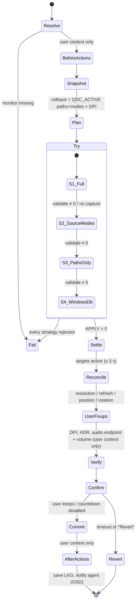
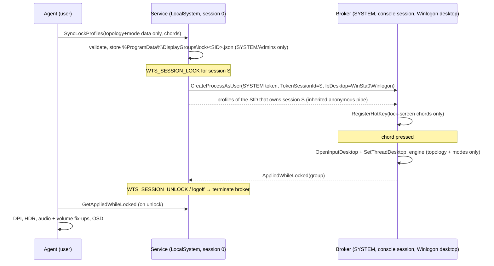

# DisplayGroups — Architecture

> Status: **Approved for v1.0** (Phase 1 sign-off 2026-11-19). **Phase 2 (core engine + CLI) done**:
> 68 automated tests pass. Read-only commands were checked on the test machine: `status`,
> `capture`, `list` and `validate`. Real switching (`apply`, `toggle`, `recover`) has not been run
> on hardware yet; per D3 that happens on a VM or secondary PC.
>
> **Phase 3 in progress.**
> - **Done:**
>   - `dg-hotkey`: chord parsing and the reserved/known-conflict tables.
>   - The agent: hotkeys with a live conflict probe, the OSD, config hot reload, the disconnect
>     fallback and single-instance.
>   - `dg-ipc`: protocol, framing and the secured pipe with caller identity.
>   - The §8.5 spike tool.
>   - 86 automated tests pass.
> - **Checked on the test machine in `--dry-run`, displays unchanged:**
>   - hotkey → OSD → fade-out;
>   - the switch broadcast → OSD;
>   - conflict detection, which reported `Ctrl+Alt+F12` as held by the old PowerShell agent;
>   - live reload, single instance and clean shutdown.
> - **Waiting on the §8.5 spike result:** the lock-screen service and broker.
>
> **Phase 4a (native parts) done**, 95 automated tests:
> - **Tray icon and menu:**
>   - Contents: groups with the current one checked, Recover, Settings…, Start with Windows,
>     Start minimized and Exit.
>   - It is re-added when Explorer restarts.
> - **"Keep these display settings?" countdown dialog:**
>   - An owner-painted Win32 window that follows the theme and works from the keyboard.
>   - Revert has the initial focus.
>   - It replaces the message box.
> - **Built-in icons** are generated at run time from Segoe Fluent Icons glyphs as multi-size
>   `.ico` files; custom `.ico`/`.png` can be imported.
> - **`shortcut` command:** `IShellLinkW` with known-folder paths for the Desktop and
>   `Start Menu\Programs\DisplayGroups`.
> - **`startup` and `protocol` commands:** both write to HKCU only.
> - **Application manifest** embedded in both binaries: common controls v6, PerMonitorV2, UTF-8.
> - **`locales/en.json`:** shared UI strings for the native parts and the settings app.
>
> Checked on the test machine, displays unchanged:
> - The dialog and the OSD were captured in dark and light themes and reviewed.
> - Icons were reviewed at 16–256 px.
> - Shortcuts with Arabic names were written to a temporary folder.
> - The tray icon was registered. A simulated right-click reached the menu code, but a menu
>   only appears for a real click, because Explorer grants foreground rights only then.
>
> **Phase 4b (settings app) done:** `apps/settings`, Tauri v2 + TypeScript + Vite, ~50 KB of JS.
> - **Groups:**
>   - List with drag reorder, duplicate, and delete with undo.
>   - Editor with the 2D canvas: drag with 8 px edge snapping, primary kept at (0,0), overlaps refused.
>   - Per-display settings. Resolution and refresh pickers come from the modes the monitor
>     really offers when it is on.
>   - Sound, actions, capture, validate and test.
> - **Hotkeys:** recording and a live availability check against other programs.
> - **Other pages:** Shortcuts, Settings and Diagnostics (with import/export).
> - **Theme:** System/Dark/Light, kept in step with the native title bar and Mica.
> - **Start, motion and text:**
>   - No white flash on start (hidden window, then fade-in).
>   - Animations use only transform/opacity and respect reduced motion.
>   - All strings come from `locales/en.json`, with RTL-safe CSS.
> - **How it works:**
>   - Config editing, validation, display status and modes, and the hotkey probe run in-process.
>   - Capture, validate, shortcut, startup, protocol and test-apply run the CLI next to the app,
>     so there is one implementation.
> - **Checked on the test machine, displays unchanged:**
>   - Each page was captured and reviewed in dark and light.
>   - The TV's real modes (3840×2160 at 120 Hz) appeared as pickers.
>   - The hotkey check correctly reported `Ctrl+Alt+F12` as held by another program.
>   - "Discard" restores the theme.
>   - Closing the window ends the process and all its WebView2 processes.
> - **Design change:** the UI uses hand-written Fluent-style CSS instead of Fluent UI Web
>   Components. It is lighter, has no runtime UI dependency, and gives full control over RTL.
> - **Not done yet:**
>   - "Identify" (numbers on each screen).
>   - Picking a custom icon file from the UI (the CLI's `shortcut --icon` supports it).
>   - Translations beyond English.
>
> Items marked **[VERIFIED]** were observed on real hardware (Windows 11 26H2 build 26300, RTX 5080,
> ASUS XG32UCWMG + DFI27280 + Samsung 65" TV over HDMI) while building the PowerShell prototype this
> project replaces. Items marked **[SPIKE]** are unproven and get a go/no-go test before code depends on them.

---

## 0. Decision log

| # | Decision | Status |
|---|---|---|
| D1 | Rust Cargo workspace (`windows-rs`) for engine, CLI, tray agent and optional service; Tauri v2 for an on-demand settings UI that exits completely on close | Approved |
| D2 | Product name **DisplayGroups**: binaries `displaygroups*.exe`, config `%APPDATA%\DisplayGroups\`, pipe/mutex names `DisplayGroups.*`, URI scheme `displaygroups://` | Approved |
| D3 | Smart App Control stays **on** on the dev PC. Logic is tested through unit and mock-backend tests, on GitHub Actions `windows-latest` if SAC blocks local test binaries. Real-hardware testing of unsigned builds, including the §8.5 spike, happens on a Windows 11 VM or secondary PC with SAC off. Public releases target **SignPath Foundation** through `scripts/sign.ps1` | Approved |
| D4 | Toolchain: rustup (stable MSVC), Visual Studio Build Tools 2022 (C++ workload + Windows SDK) and Git. Node.js LTS is installed when Phase 4 starts, because Phases 2–3 don't need it | Approved |
| D5 | Repository at `C:\Users\ahmad\Projects\DisplayGroups`, MIT license | Approved |
| D6 | v1.0 additions: theme switcher, flash-free launch, motion, i18n/RTL readiness, OSD, Duplicate Group, per-group volume, pre/post-switch actions, `displaygroups://` URI, disconnect auto-fallback | Approved (§9–§11) |
| D7 | Deferred to v1.1: window-position restore, automatic triggers, DDC/CI brightness, auto-updater | Roadmap only (§15) |

---

## 1. Tech stack

**Rust for everything that runs in the background, plus Tauri v2 for the settings window only, started on demand.**

| Criterion | Rust + Tauri v2 | C# .NET 8/9 (rejected) |
|---|---|---|
| Background RAM (tray agent) | ~3–8 MB, pure Win32, no runtime | ~15–30 MB NativeAOT; WPF cannot be NativeAOT-compiled |
| Win32 / CCD access | `windows-rs` (Microsoft-maintained), structs generated from Win32 metadata | CsWin32, equally complete |
| Windows Service | `windows-service` crate, small static binary | Worker Service, larger |
| GUI | WebView2 (preinstalled on Win11), Fluent UI Web Components, easy 2D canvas | WPF-UI is native-looking but heavier and not AOT |
| Distribution | Static `.exe` files, no runtime | Self-contained ≈ 70–150 MB, or a runtime dependency |

The RAM budget can only be met by keeping the GUI out of the always-running process. The background
is a pure-Win32 Rust agent, including the OSD (§10). The settings UI is a separate process, so
WebView2's ~80–150 MB is only paid while the user is configuring.

---

## 2. Process model

```mermaid
flowchart LR
  subgraph User session (console)
    A[displaygroupsw.exe agent\ntray, hotkeys, OSD,\ndisconnect fallback]
    U[displaygroups-settings.exe\nTauri, on demand]
    C[displaygroups.exe\nCLI, console]
    W[displaygroupsw.exe apply / uri ...\nshortcuts + displaygroups:// , no console]
    B[displaygroups-svc.exe broker\nSYSTEM token, Winlogon desktop\nonly while locked]
  end
  subgraph Session 0
    S[displaygroups-svc.exe\nWindows Service, LocalSystem\noptional, installer-only]
  end
  U -- edits --> CFG[(%APPDATA%\\DisplayGroups\\config.json)]
  A -- watches --> CFG
  C & W & A & U -- link --> E[dg-engine]
  A <-- named pipe --> S
  S -- spawns on lock / kills on unlock --> B
  S <-- inherited anonymous pipe --> B
```

| Binary | Subsystem | Runs as | Lifetime | Purpose |
|---|---|---|---|---|
| `displaygroups.exe` | console | user | per command | CLI for terminals and scripts |
| `displaygroupsw.exe` | windows | user | per command, or `agent` (resident) | Same commands with no console flash, plus `uri <url>` for the protocol handler. `agent` = tray, hotkeys, OSD, disconnect fallback and post-unlock fix-ups |
| `displaygroups-settings.exe` | windows | user | while window open | Tauri v2 settings UI |
| `displaygroups-svc.exe` | windows | LocalSystem | service; `broker` subcommand when spawned | Optional lock-screen support |

- The console/windows pair follows the `python.exe`/`pythonw.exe` pattern. Rust starts in a few
  milliseconds, so shortcuts run the engine directly without IPC to the agent.
- A named mutex (`Local\DisplayGroups.Apply`) serializes concurrent switches.
- When a switch is started by `displaygroupsw.exe` (shortcut, URI) and the agent is running, the
  engine posts `DG_SWITCHED` to the agent's message-only window, and the agent shows the OSD. If the
  agent isn't running, there is no OSD: OSD rendering lives only in the agent.

**Hotkeys come only from the agent**, never from `.lnk` files. Shortcut-file hotkeys never fired on the
test machine, from either the Start Menu or the Desktop **[VERIFIED]**. `RegisterHotKey` in a resident
process did work **[VERIFIED]**.

---

## 3. Repository layout

```
DisplayGroups/
├─ Cargo.toml                    # workspace, shared lints/profile
├─ crates/
│  ├─ dg-model/                  # config schema (serde), validation, migrations, atomic save — no Win32
│  ├─ dg-identity/               # EDID parsing + monitor matching — no Win32
│  ├─ dg-win/                    # all unsafe Win32: CCD, DEVMODE, EDID via SetupAPI, DPI, HDR,
│  │                             #   audio endpoint + volume, shell links, process launch
│  ├─ dg-engine/                 # switching state machine over the `DisplayBackend` trait
│  ├─ dg-hotkey/                 # chord parsing, RegisterHotKey loop, conflict probe        (Phase 3)
│  └─ dg-ipc/                    # pipe protocol, framing, secured pipe server/client         (Phase 3)
├─ apps/
│  ├─ cli/                       # displaygroups.exe + displaygroupsw.exe (agent + OSD in Phase 3)
│  ├─ svc/                       # displaygroups-svc.exe (service + broker)                  (Phase 3)
│  └─ settings/                  # Tauri v2: src-tauri/ + ui/ (TypeScript, Vite, Fluent UI WC) (Phase 4)
├─ assets/icons/                 # built-in SVG sources + generated multi-size .ico
├─ locales/                      # en.json (UI strings; shared by settings UI and agent tray/OSD)
├─ tests/fixtures/topologies/    # recorded QueryDisplayConfig dumps
├─ installer/nsis/               # per-machine installer, optional service + URI components (Phase 5)
├─ packaging/portable/           # portable ZIP layout + portable.flag                        (Phase 5)
├─ scripts/                      # build.ps1, sign.ps1 (no-op without secrets)
├─ tools/lockscreen-spike/       # §8.5 go/no-go test; test machines only (docs/lockscreen-spike.md)
├─ .github/workflows/            # ci.yml (push/PR), release.yml (tags)
├─ docs/                         # CLI reference, troubleshooting
└─ README.md  ARCHITECTURE.md  CONTRIBUTING.md  SECURITY.md  LICENSE
```

`dg-engine` depends only on the `DisplayBackend` trait. CI runs it against a fake backend that replays
recorded topologies and scripted `SetDisplayConfig` results, including the 31/87 failures from §6.

---

## 4. Stable monitor identity

Volatile values are never persisted: `\\.\DISPLAYn`, `targetId`, `sourceId` and the adapter LUID.
On the test machine the GDI names moved from `DISPLAY1/2` to `DISPLAY27/28` across sessions, and the LUID changed after a reboot **[VERIFIED]**.

**Collected per target**, via `QDC_ALL_PATHS` + `DisplayConfigGetDeviceInfo(GET_TARGET_NAME)` + the EDID
read with SetupAPI from the monitor device's `Device Parameters\EDID`:

| Field | Source | Example (test machine) |
|---|---|---|
| `pnpId` | EDID bytes 8–9 (or `edidManufactureId`) | `SAM` |
| `productCode` | EDID bytes 10–11 (or `edidProductCodeId`) | `721B` |
| `serial` | `0xFF` descriptor string, else EDID bytes 12–15 if non-zero | `376965120` |
| `friendlyName` | target name / `0xFC` descriptor | `SAMSUNG` |
| `connectorHint` | `UIDnnnn` from the monitor device path | `UID4352` |
| `adapterHint` | adapter device path | `PCI\VEN_10DE…` |
| `outputTechnology` | target info | `hdmi` |

**Matching, strongest first.** A tier is used only if it gives a unique match among currently
*available* targets. Stale PnP instances are ignored, and the test machine had 11 for 3 monitors **[VERIFIED]**.

1. `pnpId + productCode + serial` (serial present and not shared by another connected monitor)
2. `pnpId + productCode + connectorHint` (identical twin monitors with no serial)
3. `pnpId + productCode` (the user moved the cable to another port)
4. `friendlyName` (weak; reported as an uncertain match)

If nothing matches, the engine fails with `MonitorMissing(<display name>)` before any API call.

---

## 5. Configuration schema (v1)

`%APPDATA%\DisplayGroups\config.json` (portable: `.\data\config.json`) is UTF-8 and human-readable.
- Writes are atomic: a temp file in the same directory, then `MoveFileExW(REPLACE_EXISTING | WRITE_THROUGH)`.
- Before a migration, the old file is copied to `config.v{n}.bak.json`.
- Logs: `%LOCALAPPDATA%\DisplayGroups\logs\`, rotated daily, 7 kept.
- Last-known-good layout: `%LOCALAPPDATA%\DisplayGroups\state\lkg.json`. It is machine-local and contains raw CCD arrays, so it is never synced or exported.

```jsonc
{
  "schemaVersion": 1,
  "monitors": {
    "mon-sam-721b-376965120": {
      "displayName": "Living-room TV",
      "identity": { "pnpId": "SAM", "productCode": "721B", "serial": "376965120",
                    "friendlyName": "SAMSUNG", "connectorHint": "UID4352",
                    "adapterHint": null, "outputTechnology": "hdmi" }
    }
  },
  "groups": [
    {
      "id": "6b0f2c1e-…",                    // UUID; shortcuts, hotkeys and URIs reference ids, never names
      "name": "Gaming on Couch",
      "icon": "builtin:couch",               // builtin:<monitor|couch|dual|gaming|work> or file:<name>.ico
      "othersPolicy": "disable",             // monitors not listed: "disable" | "leave"
      "displays": [
        { "monitor": "mon-sam-721b-376965120", "enabled": true,
          "mode": { "width": 3840, "height": 2160, "refreshMilliHz": 120000,
                    "refreshPolicy": "bestAtOrBelow" },        // "exact" | "bestAtOrBelow"
          "position": { "x": 0, "y": 0 },                      // (0,0) == primary
          "rotation": "landscape",                             // landscape | portrait | landscapeFlipped | portraitFlipped
          "scalePercent": 175,                                 // null = leave Windows' value
          "hdr": null,                                         // true | false | null
          "captured": null }                                   // opaque timing blob from "Capture" (S1)
      ],
      "audio": { "enabled": false,
                 "endpoint": { "nameContains": "SAMSUNG" },     // matched against endpoint friendly names
                 "volumePercent": 40 },                         // 0..=100, null = leave unchanged
      "actions": { "enabled": false,                            // off by default
                   "allowFromUri": false,                       // URI-triggered switches skip actions unless true
                   "before": [],
                   "after": [ { "kind": "open", "target": "steam://open/bigpicture" },
                              { "kind": "program", "path": "C:\\Program Files\\Kodi\\kodi.exe",
                                "args": [], "workingDir": null } ] },
      "safety": { "confirmSeconds": 15 }                       // 0 = no countdown for this group
    }
  ],
  "hotkeys": [
    { "chord": "Ctrl+Alt+F12", "action": { "type": "toggle", "groups": ["<desktop>", "<couch>"] },
      "onLockScreen": true },
    { "chord": "Ctrl+Alt+Shift+F12", "action": { "type": "recover" }, "onLockScreen": true }
  ],
  "settings": {
    "theme": "system",                    // system | dark | light
    "language": "en",
    "startWithWindows": true, "startMinimized": true,
    "osd": { "enabled": true, "durationMs": 1800 },
    "disconnectFallback": { "enabled": false, "group": null, "debounceMs": 3000 },
    "lockScreenSupport": false,
    "logLevel": "info"
  }
}
```

**Validation rules** (in `dg-model`; violations are reported, not silently fixed):
- Every referenced monitor and group id exists. Group names are non-empty, and names are unique, case-insensitively.
- An enabled group has ≥ 1 enabled display, and exactly one enabled display sits at `(0,0)`.
- Enabled displays don't overlap. Every display touches another display along an edge (no gaps), or
  is joined to one by a chain of such displays. The size used for this check comes after rotation.
- `volumePercent` is in `0..=100`. `scalePercent` is one of `100,125,150,175,200,225,250,300,350,400,450,500`.
- `refreshMilliHz` is greater than 0. `confirmSeconds` is in `0..=120`.
- Unknown fields are preserved, so files written by a newer version are not lost.
- Export can redact serial numbers for issue reports.

---

## 6. Switching engine (`SetDisplayConfig` state machine)



**Path building**
- Each enabled display gets a source on its own adapter, unique per adapter. The engine prefers the
  source id that target last used.
- Every field is populated: `rotation` from the profile, `scaling = IDENTITY`,
  `scanLineOrdering = UNSPECIFIED` (0 is valid), and `refreshRate = 0/0` when the target mode is left to Windows.
- Rotation 0 or scaling 0 caused `ERROR_INVALID_PARAMETER` (87) **[VERIFIED]**. A builder invariant
  test makes sure this can never be produced.

**Strategy ladder.** Each strategy runs `SDC_VALIDATE` first, then `SDC_APPLY` with the same arrays.

| # | Flags | Arrays | When it helps |
|---|---|---|---|
| S1 | `USE_SUPPLIED \| SAVE_TO_DATABASE` | paths + source modes + captured target timings | Exact result in one mode set, no second flicker. Needs "Capture". |
| S2 | `USE_SUPPLIED \| ALLOW_CHANGES \| SAVE_TO_DATABASE` | paths + source modes, target mode index invalid | Capture missing or rejected after a driver update |
| S3 | `USE_SUPPLIED \| ALLOW_CHANGES \| SAVE_TO_DATABASE` | paths only, no modes | Fixed the real error-31 case on the TV **[VERIFIED]** |
| S4 | `TOPOLOGY_SUPPLIED \| ALLOW_PATH_ORDER_CHANGES` | paths only | Windows still remembers the set **[VERIFIED]** |

Flag rules **[VERIFIED]**:
- `ALLOW_PATH_ORDER_CHANGES` combined with `USE_SUPPLIED` → 87. It is only used with `TOPOLOGY_SUPPLIED`.
- `TOPOLOGY_SUPPLIED` without `ALLOW_PATH_ORDER_CHANGES` → 31, even for a set Windows remembers.
- After a reboot or driver update, Windows forgot the TV-only set: S4 → 31 on every source id, while
  S3 succeeded and re-saved it.

**Error policy**

| Code | Meaning in practice | Action |
|---|---|---|
| 31 `ERROR_GEN_FAILURE` | Windows has no saved settings for this set | Next strategy |
| 87 `ERROR_INVALID_PARAMETER` | Our arrays are wrong | Log the full arrays; next strategy |
| 5 `ERROR_ACCESS_DENIED` | Caller's thread is not on the input desktop (locked, UAC, RDP) | Route to the broker if available, else `Locked` error |
| target unavailable | Monitor unplugged or not detected | Fail before calling, naming the monitor |

**Reconcile.** Re-query and compare with the profile. Resolution, position and rotation are
corrected through CCD source modes. The refresh rate uses **best ≤ target** from the mode list
(`refreshPolicy: bestAtOrBelow`), comparing rationals with a 500 mHz tolerance (119.88 vs 120).

**User-context fix-ups**
- **DPI:** undocumented `DisplayConfig{Get,Set}DeviceInfo` types −3/−4, the mechanism Settings uses.
  The value is relative to the recommended step: `recommendedIndex = -min`. The engine checks
  `min ≤ rel ≤ max` and re-reads the value after setting it. If GET fails, DPI control turns off with a
  warning instead of guessing. When Windows forgot the TV set, it also reset the TV to "Recommended"
  (300%) and the user had to set 175% again **[VERIFIED]**.
- **HDR:** advanced-color state through `DisplayConfigSetDeviceInfo`. It is skipped when the target
  reports no support.
- **Audio:** the default endpoint is set via `IPolicyConfig`. This interface is undocumented but widely used, so it stays behind a feature flag.
  The engine waits up to 5 s for the endpoint to appear, because the TV's HDMI endpoint only appears
  after the TV is active. Then it sets `volumePercent` through the documented `IAudioEndpointVolume::SetMasterVolumeLevelScalar`.

**Black-screen safety net**
- **Countdown:** a topmost "Keep these display settings?" dialog on the new primary, 15 s by default.
  On timeout it re-applies the rollback snapshot with exact arrays. The countdown is set per group, and
  `--no-confirm` / `--force` skip it.
- **Recover:** a failsafe hotkey and `displaygroups recover` re-apply the last-known-good layout.
  `recover --extend` calls `SetDisplayConfig(SDC_TOPOLOGY_EXTEND)`, which validated on the test machine **[VERIFIED]**.
- **Lock screen:** switches made there skip the countdown and before/after actions.

---

## 7. Hotkeys (Phase 3)

- The agent runs `RegisterHotKey(NULL, id, mods | MOD_NOREPEAT, vk)` on its UI thread and
  re-registers when `config.json` changes (`ReadDirectoryChangesW`).
- WM_HOTKEY messages that queue up while a switch is running are discarded afterwards.
- **Conflict detection:**
  1. A live probe registers and immediately unregisters the chord. On the test machine `Alt+Z` and
     `Alt+F10` were already held by the NVIDIA overlay **[VERIFIED]**.
  2. A curated table of overlay defaults.
  3. Documented blind spots: in-game bindings and low-level hooks.
- Chords are stored by virtual key, so they work regardless of keyboard layout.
- Actions: `apply`, `toggle`, `cycle`, `recover`.

---

## 8. Lock-screen support (Phase 3, optional, installer-only)

### 8.1 Why a service is required
- While the session is locked, the input desktop is `WinSta0\Winlogon`, and only SYSTEM can open it.
- `RegisterHotKey` from `Default` does not see keys typed there.
- `SetDisplayConfig` must be called from a thread attached to the input desktop, otherwise it returns
  `ERROR_ACCESS_DENIED`. A public Sunshine pull request reports the same and fixes it by attaching the
  calling thread to the input desktop for each call.

### 8.2 Design



`SyncLockProfiles` carries only display geometry, modes and chords. **Audio, actions, icons and
paths are never sent to the service.** Pre/post-switch actions run only in user context, in the CLI
or the agent.

### 8.3 IPC and privilege model

**Service pipe** `\\.\pipe\DisplayGroups.Service.v1`
- DACL: SYSTEM and Administrators get full control; INTERACTIVE gets read/write. `PIPE_REJECT_REMOTE_CLIENTS` is set.
- Framing: a 4-byte length prefix, then versioned JSON. Messages are capped at 64 KB, with timeouts.
- Caller identity: `GetNamedPipeClientSessionId`, then `ImpersonateNamedPipeClient` to read the caller's SID.
- Storage is per SID. The broker only ever receives the data of the SID that owns the locked session.

**Broker channel**
- An anonymous pipe pair, inherited explicitly through `PROC_THREAD_ATTRIBUTE_HANDLE_LIST`.
- The broker never reads user-writable files.

**Broker token**
- A SYSTEM duplicate with privileges stripped where the desktop calls still allow it.
- The broker has no UI.

**Service**
- Runs as LocalSystem; it needs `SeTcbPrivilege` to set `TokenSessionId`.
- Declares only its required privileges.
- Installed only when chosen in the installer, and stopped while no lock-screen chord exists.
- Refuses to spawn the broker unless its own image is under `%ProgramFiles%`.

### 8.4 Non-negotiable rule
The broker uses `RegisterHotKey` **only**. It never uses `WH_KEYBOARD_LL`, Raw Input or anything else
that could observe other keys, such as a password typed on the lock screen.

### 8.5 [SPIKE] go/no-go (run on the VM / secondary PC per D3)
1. The broker starts on `WinSta0\Winlogon` in the console session while it is locked.
2. `RegisterHotKey` there delivers WM_HOTKEY while locked. No public source confirms this.
3. `SetDisplayConfig` succeeds from the broker.

If (2) fails, lock-screen hotkeys ship disabled and documented. There is no fallback to hooks.

Tool: `tools/lockscreen-spike`; steps in `docs/lockscreen-spike.md`. The broker it starts calls
`SetDisplayConfig` with `SDC_VALIDATE` only, so the spike never changes the displays.

---

## 9. Settings UI (Phase 4)

- **Stack as built:** TypeScript + Vite with hand-written Fluent-style CSS (decided in Phase 4b
  instead of Fluent UI Web Components).
- **Pages:** Groups, Group editor, Hotkeys, Shortcuts, Settings, Diagnostics.
- **Groups list:** create, rename, reorder (drag), delete with undo, and **Duplicate**. Duplicate
  deep-copies the group under a new id named "<name> (copy)". Hotkeys and shortcuts are not copied.
- **Theme:** a `System / Dark / Light` segmented toggle in the header and on the Settings page.
  - A change applies immediately: CSS variables, the native title bar via Tauri `set_theme`, and the
    Mica backdrop via window effects.
  - `system` follows `prefers-color-scheme` live.
- **No white flash:** the window is created with `visible: false` and a background color that matches
  the resolved theme. The theme class is set before the first paint, CSS is loaded and the app is
  mounted, then `show()` runs with a 150 ms opacity fade-in.
- **Motion:** animations use only `transform` and `opacity`, for pages, modals and canvas snapping.
  All of it turns off under `prefers-reduced-motion: reduce`.
- **i18n/RTL from day one:**
  - Every string is in `locales/en.json` with ICU-style keys, and there are no literals in components.
  - CSS uses only logical properties (`margin-inline`, `padding-inline`, `inset-inline`, `text-align: start`), with `dir` set from the locale.
  - The layout canvas keeps physical coordinates, because screen geometry is not mirrored, but its toolbars follow `dir`.
  - The tray menu and OSD read the same locale files.
- **Layout canvas:**
  - Monitors are scaled rectangles, sized after rotation.
  - Drag with 8 px edge snapping and no overlaps; exact X/Y fields underneath.
  - "Identify" flashes numbers on each screen.
  - "Capture current setup" saves the current layout and the timings that strategy S1 uses.
  - "Test" applies the group with the countdown.
- **Shortcut generator:**
  - Native `IShellLinkW` + `IPersistFile`. On the test machine `WScript.Shell` failed to save to a non-ASCII (Arabic) OneDrive Desktop path **[VERIFIED]**.
  - Targets `displaygroupsw.exe apply --id <uuid>`. Start Menu copies go in `Programs\DisplayGroups\`.
  - Icons: the built-in set or a custom `.png`/`.ico`, converted to a multi-size ICO.
  - Pinning cannot be automated, so the UI tells the user how to do it.

---

## 10. On-screen display (OSD) (Phase 3, agent)

- **Window:**
  - A pure-Win32 layered window inside the agent: `WS_POPUP` with `WS_EX_LAYERED | WS_EX_TRANSPARENT |
    WS_EX_TOOLWINDOW | WS_EX_TOPMOST | WS_EX_NOACTIVATE`. It is click-through, never takes focus and stays out of the taskbar.
  - It is created once and reused. **WebView2/Tauri is never used for the OSD.**
- **Content:**
  - The group icon (`DrawIconEx`), the group name and the active resolution/refresh of the new primary,
    for example `3840 × 2160 · 120 Hz`.
  - Drawn with GDI on a rounded panel. DWM supplies the rounded corners (`DWMWA_WINDOW_CORNER_PREFERENCE`).
  - Text uses Segoe UI Variable at the monitor's DPI, and the theme matches the settings.
- **Placement:** bottom-center of the new primary's work area, 10% above the bottom edge, per-monitor DPI aware (v2).
- **Timing:**
  - Fades in over 150 ms, holds for `osd.durationMs − 300`, then fades out over 150 ms.
  - Fades step global alpha (`SetLayeredWindowAttributes`) on a timer.
  - With reduced motion it appears and disappears without fades.
- **Triggers:** switches from hotkeys, the tray, shortcuts and the URI. Shortcut and URI switches reach
  the agent through `DG_SWITCHED`, posted to its message-only window.
- **Budget:** no extra threads and no image libraries; it must fit inside the agent's ≤ 10 MB.

---

## 11. Integrations (v1.0)

### 11.1 Pre/post-switch actions
- **Off by default**, per group (`actions.enabled`).
- They run only in user context, from `displaygroups[w].exe` or the agent. They are **never** sent to,
  stored by or run by the service or broker, and they are skipped for lock-screen switches.
- `program`: `CreateProcessW` with an argv array, quoted per the MSVCRT rules. There is no shell and no
  `cmd /c`, so there is no command-string injection.
- `open`: `ShellExecuteExW("open", target)` for URLs and registered protocols such as
  `steam://open/bigpicture`.
- `before` actions run before Snapshot. `after` actions run after Commit, and only if the switch was kept.
- Actions are fire-and-forget: the engine does not wait for them, and their failures are logged but
  never fail the switch.

### 11.2 `displaygroups://` URI protocol
- **Opt-in**, from the installer checkbox or a Settings toggle.
- Registered per user under `HKCU\Software\Classes\displaygroups` with the command
  `"<dir>\displaygroupsw.exe" uri "%1"`.
- Accepted forms only: `displaygroups://apply/<uuid>` and `displaygroups://toggle/<uuid>,<uuid>`. Each
  id must be a UUID that exists in the config. Anything else is rejected and logged, and there are no
  other parameters.
- Any web page can try to open a custom URI; browsers ask the user first. Therefore:
  - URI switches use the group's confirmation countdown;
  - they skip before/after actions unless `actions.allowFromUri` is true;
  - they are rate-limited to 1 per 3 s.

### 11.3 Disconnect auto-fallback
- **Opt-in** (`settings.disconnectFallback`).
- **Detection:** the agent listens for `WM_DISPLAYCHANGE` and for `WM_DEVICECHANGE` on
  `GUID_DEVINTERFACE_MONITOR` (registered with `RegisterDeviceNotificationW`).
- **Trigger:** after `debounceMs` (default 3 s) of quiet, the agent re-queries. It acts only if no
  target that was active before the event is still active and available, meaning the sole or every
  active display disappeared.
- **Guards:**
  - Ignore events during an engine-initiated switch and for 10 s after it.
  - At most one auto-fallback per 60 s.
  - Never fall back to a group whose monitors are not all available.
  - Skip while locked.

---

## 12. Memory budget

| Process | Target | When |
|---|---|---|
| Agent (`displaygroupsw.exe agent`, incl. OSD) | ≤ 10 MB private bytes | always (tray) |
| Service | ≤ 5 MB | only when installed and a lock-screen chord exists |
| Broker | ≤ 8 MB | only while locked |
| Settings (Tauri + WebView2) | ~80–150 MB | only while open; the process exits on close |

**Measured (release build, test machine, 2026-11-19) [VERIFIED]:**

| State | Private bytes | Working set |
|---|---|---|
| Idle | 6.4 MB | ~0.5 MB |
| While the OSD shows | 6.4 MB | 3.5 MB |

- The binary is ~2 MB.
- Before trimming, the working set was ~20 MB. Almost all of it was shared Windows DLL pages
  loaded by window creation and font rendering.
- The agent therefore trims its working set (`K32EmptyWorkingSet`) whenever it goes idle: after
  start-up, and after each switch once the OSD has faded.
- Private bytes is the budgeted figure, because it is the memory the agent really holds.
- An automated CI check is still to do: it needs an interactive desktop session on the runner.

---

## 13. Packaging, signing and Smart App Control (Phase 5)

- **Installer:** NSIS, per-machine, installed to `%ProgramFiles%\DisplayGroups`. Optional components:
  the lock-screen service and the `displaygroups://` protocol. Uninstall removes everything and asks
  before deleting user config.
- **Portable ZIP:** `portable.flag` switches the config to `.\data\`. There is no service, and lock-screen features are hidden with an explanation.
- **Release workflow:** on tag, run fmt, clippy and tests, then build, **sign**, run NSIS, make the ZIP
  and `SHA256SUMS.txt`, and publish the GitHub Release.
- **Signing:** `scripts/sign.ps1` signs every `.exe`, `.dll` and the installer. It is a no-op without
  secrets, and the target is SignPath Foundation (D3).
- **Smart App Control:** it blocks unsigned binaries, and a self-signed certificate does not count,
  even when trusted locally. The README explains this, along with SmartScreen and building from source.

---

## 14. Testing strategy

**Unit tests**
- `dg-model`: schema round-trips, validation rules and migrations.
- `dg-identity`: EDID parsing and matching tiers, including identical twin monitors without serials.

**Engine tests** (`dg-engine` against a fake backend)
- The S1 → S4 ladder with scripted 31/87 results.
- Builder invariants: no rotation/scaling 0, no `ALLOW_PATH_ORDER_CHANGES` with `USE_SUPPLIED`, unique sources per adapter.
- Primary at (0,0), the refresh fallback, `MonitorMissing`, the revert path, and actions skipped for URI/lock.

**CI:** `ci.yml` on `windows-latest` runs `cargo fmt --check`, `clippy -D warnings` and
`cargo test --workspace`. CI is the authoritative test run when SAC blocks local test binaries (D3).

**Hardware:** `displaygroups validate <group>` uses `SDC_VALIDATE` only and never changes anything.
Real switching is tested on the VM / secondary PC (D3).

**Phase 2 hardware checks (2026-11-19, test machine, read-only) [VERIFIED]:**
- The EDID is read from the registry: the TV's serial 376965120 matches Windows' own
  `PerMonitorSettings` key `SAM721B376965120…`.
- The Samsung TV runs at 3840×2160 **120 Hz**, and the 175% scale is read back correctly through the DPI packets.
- `validate` was run for both groups:
  - "Gaming on Couch" (captured): S1 accepted, using the captured timings.
  - "Desktop" (TV off → ASUS + DFI on): S2 accepted.
  - Neither validation changed the screen.
- `status` recognised the group currently on screen.

---

## 15. Roadmap — deferred to v1.1 (not in v1.0)

- Saving and restoring open window positions across switches.
- Automatic profile triggers (game launch, controller connect).
- DDC/CI hardware brightness control.
- Built-in GitHub Releases auto-updater.
