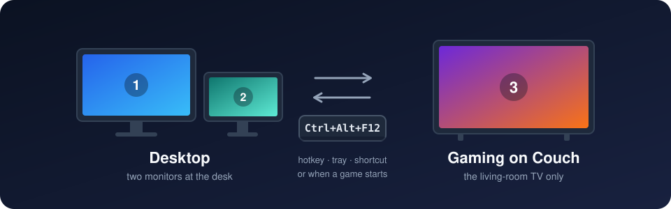

<div align="center">



# DisplayGroups

**Switch your PC between groups of displays with one click, a hotkey, or automatically.**

[](https://github.com/17MaDh/DisplayGroups/actions/workflows/ci.yml)
[](LICENSE)
[](#install)
[](#linux-preview)
[](https://www.rust-lang.org)
[](https://tauri.app)

[Features](#features) · [Install](#install) · [Getting started](#getting-started) ·
[Command line](#command-line) · [Linux](#linux-preview) · [Architecture](ARCHITECTURE.md)

</div>

Monitors at the desk for work, the living-room TV for games. A **group** remembers which
displays are on, and for each one the primary, resolution, refresh rate, position, rotation,
scale and HDR. It can also set the sound output and volume. For example, "Desktop" (two
monitors) and "Gaming on Couch" (the TV only).

> **Status: pre-release.**
> - **Built and tested:**
>   - the switching engine and command line;
>   - the background agent (hotkeys, tray, on-screen display);
>   - the settings app;
>   - the installer and portable ZIP;
>   - the release pipeline.
> - **Next:** testing real switching on more hardware before 1.0.
> - **In progress:** the Linux port for GNOME ([Linux (preview)](#linux-preview)). The
>   command line and the agent work; the settings app is next.
> - **Waiting on a feasibility test:** hotkeys on the lock screen
>   ([docs/lockscreen-spike.md](docs/lockscreen-spike.md)).
>
> See [ARCHITECTURE.md](ARCHITECTURE.md) for the design.

## Features

- **Groups** remember monitors by their EDID identity, so they survive cable and port changes.
  Twin monitors without serial numbers are told apart by connector.
- **Switching**
  - Tries the most exact method first and falls back to safer ones.
  - Asks "Keep these display settings?" and reverts after 15 seconds unless you confirm.
  - `recover` restores the last layout that worked.
- **Hotkeys**
  - Global chords such as `Ctrl+Alt+F12`.
  - When another program holds a chord, the agent says which one, if it can tell.
- **Tray and on-screen display:** a quick-switch menu, and a short "Gaming on Couch" toast after
  each switch.
- **Settings app**
  - Shows what Windows has on screen now and which group that is. It updates as soon as you
    change displays in Windows, or when the config changes elsewhere.
  - **New group** builds a group by hand, without switching to it first. Add each display it
    turns on, even one that is off right now (a TV). A display starts from its settings in
    another group, else its current mode, else its native mode from the EDID.
  - A drag-and-drop layout editor, with resolution and refresh pickers from the modes each
    monitor really offers.
  - **Update from screen** replaces a group's layout with what Windows shows now. After you edit
    the group that is on screen, it offers to apply the changes, since saving alone does not
    change your displays.
  - Pages for hotkeys, shortcuts, theme (System/Dark/Light), import/export and diagnostics.
- **Identify:** shows each screen's number and name on that screen, matching the numbers in the
  layout editor.
- **Shortcuts:** desktop or Start menu shortcuts that switch to a group, with built-in icons or
  your own `.ico`/`.png`.
- **Languages:** English and Arabic, with a right-to-left layout in the settings app, the tray,
  the on-screen display and the confirmation dialog.
  - By default the app follows the Windows display language.
  - Another language is one JSON file ([CONTRIBUTING.md](CONTRIBUTING.md#translations)).
- **Links:** `displaygroups://` links for Stream Deck and automation tools (opt-in).
- **Automatic switching:** switches to a group when a program starts (a game, or Steam in Big
  Picture) or a game controller connects, and back when it ends.
  - It reacts to changes only, so Steam starting with Windows doesn't move you to the TV.
  - It switches back only if you are still on that group.
- **Disconnect fallback:** optionally switches to a fallback group when a display disappears.
- **Before/after actions** (off by default): run a program or command as you, never as a
  system service.
- **Private:** no network access, no telemetry, no account.

## Install

> No release is published yet. Until the first one, [build from source](#building-from-source).

Download from [Releases](https://github.com/17MaDh/DisplayGroups/releases):

- **Installer** (`DisplayGroups-<version>-setup-x64.exe`)
  - Installs for all users in `C:\Program Files\DisplayGroups` and needs admin rights.
  - Asks whether to start with Windows and whether to enable `displaygroups://` links. You can
    change both later in Settings.
  - Uninstall from Settings → Apps. Tick "Delete the application data" to remove your groups and
    logs too.
- **Portable** (`DisplayGroups-<version>-portable-x64.zip`)
  - Unzip anywhere you can write to and run `displaygroups-settings.exe`.
  - Everything is kept in a `data` folder next to it.
  - Delete `portable.flag` to use the normal locations instead.

The settings app uses Microsoft Edge WebView2, which Windows 11 includes. On Windows 10 the
installer downloads it if it is missing.

**Check a download** against `SHA256SUMS.txt` from the same release:

```powershell
Get-FileHash .\DisplayGroups-1.0.0-setup-x64.exe -Algorithm SHA256
```

### Smart App Control and SmartScreen

Windows checks programs before running them:

- **Smart App Control** (Windows 11) blocks programs that are not code-signed. You cannot make an
  exception for one app.
  - Signed releases of DisplayGroups run normally.
  - Unsigned ones are blocked: a release says in its notes whether it is signed, and so are
    builds you make yourself.
  - We don't recommend turning Smart App Control off just for this app. Wait for a signed release,
    or use a machine where it is already off.
- **SmartScreen** may show "Windows protected your PC" for a new or unsigned download, until the
  download builds a reputation.
  - Check the SHA-256 first.
  - Then use *More info → Run anyway*.

Releases are signed through the [SignPath Foundation](https://signpath.org) programme once the
project is accepted ([docs/releasing.md](docs/releasing.md)). A self-signed certificate does not
satisfy Smart App Control, even when you trust it on your own PC.

## Getting started

1. Arrange your displays the way you want with Windows Settings → Display. Then, in
   DisplayGroups, choose **Capture current setup** and name the group.
2. For the other layouts, choose **New group**, name it (for example "Gaming on Couch") and
   add its displays with **Add a display…**. Set the mode (for example 3840×2160 at 120 Hz),
   save, and try it with **Test**. Alternatively, switch to the layout in Windows and capture
   it.
3. Add a hotkey (Hotkeys page), a shortcut (Shortcuts page), or use the tray menu.

Saving a group never changes your displays by itself. Use **Test**, a hotkey or the tray to
switch.

## Command line

`displaygroups.exe` is the console version and `displaygroupsw.exe` the same program without a
console window (use it in shortcuts). Groups can be named or given by id.

| Command | What it does |
|---|---|
| `displaygroups capture "Desktop"` | Saves the current layout as a group (creates or overwrites it) |
| `displaygroups apply "Gaming on Couch"` | Switches to a group and asks "Keep these display settings?" (reverts after 15 s) |
| `displaygroups toggle "Desktop" "Gaming on Couch"` | Switches to whichever of these is not on screen now |
| `displaygroups validate "Desktop"` | Asks Windows whether the group can be applied, **without changing anything** |
| `displaygroups list` / `status` | Shows groups and monitors / what is on screen |
| `displaygroups identify [--seconds 3]` | Shows each display's number and name on that display |
| `displaygroups duplicate "Desktop"` | Copies a group |
| `displaygroups recover [--extend]` | Restores the last layout that worked (or extends all displays) |
| `displaygroups shortcut "Gaming on Couch" [--desktop] [--start-menu] [--icon builtin:couch]` | Creates a shortcut that switches to the group. Built-in icons: `monitor`, `couch`, `dual`, `gaming`, `work`; or a `.ico`/`.png` file |
| `displaygroups startup on\|off\|status` | Starts the agent when you sign in (current user only) |
| `displaygroups protocol on\|off\|status` | Handles `displaygroups://apply/<id>` and `displaygroups://toggle/<id>,<id>` links (current user only) |
| `displaygroupsw agent [--dry-run]` | The background agent: hotkeys, tray, on-screen display, config reload. `--dry-run` only shows what a hotkey would do |

Options:
- `--no-confirm` (alias `--force`) skips the countdown.
- `--json` prints machine-readable output.
- `--config <path>` uses another config file.

Hotkeys live in `config.json`, and the settings app edits them. Example:

```json
"hotkeys": [
  { "chord": "Ctrl+Alt+F12", "action": { "type": "toggle", "groups": ["<desktop id>", "<couch id>"] } }
]
```

**Exit codes:**

| Code | Meaning |
|---|---|
| 0 | ok |
| 1 | error |
| 2 | usage |
| 3 | not kept (reverted) |
| 4 | monitor missing |
| 5 | Windows is locked |
| 6 | Windows rejected the group |

**Files:**

| What | Where |
|---|---|
| Config | `%APPDATA%\DisplayGroups\config.json` |
| Logs and the last layout that worked | `%LOCALAPPDATA%\DisplayGroups\` |
| Portable | `.\data` next to the executables, while `portable.flag` exists |

## Troubleshooting

| Problem | Fix |
|---|---|
| The screen went black or wrong after a switch | Wait 15 seconds; it reverts on its own unless you confirm. Or press your hotkey again, or run `displaygroups recover` (`recover --extend` turns every display on). |
| "Monitor missing" | The display is off, unplugged or asleep. TVs often drop off HDMI when in standby. Turn it on, or remove it from the group. |
| "Windows rejected the group" | Run `displaygroups validate "<group>"` for details. Re-capturing the group usually fixes it after a driver update. |
| A hotkey does nothing | The Hotkeys page shows whether the chord is free and, if not, which program holds it. Check that the agent (tray icon) is running. |
| Scale or refresh rate is not what you set | Check the group in the settings app. Some TVs only offer 120 Hz on certain HDMI ports or in game mode. |
| Something else | Diagnostics → Open logs folder. Attach the latest log to a bug report. |

## Linux (preview)

A port to Ubuntu's default desktop, GNOME on Wayland or X11, is under way
([ARCHITECTURE.md §16](ARCHITECTURE.md#16-linux-ubuntu-gnome)). It switches displays through
GNOME's own display service, the one GNOME Settings uses.

- **Available now: the command line.** These commands work as on Windows:
  - `status`, `list`, `capture`, `validate`, `apply`, `toggle`;
  - `duplicate`, `recover [--extend]`, and `displaygroups://` links.
- **Available now: the agent** (`displaygroups agent`):
  - a tray icon in the top bar, with the same menu as on Windows;
  - automatic switching when a program starts or a game controller connects;
  - the disconnect fallback;
  - a notification after each switch.
- **Hotkeys:** the agent writes your hotkeys into GNOME's own **Custom Shortcuts**
  (Settings → Keyboard), named "DisplayGroups: …". GNOME runs them, so they work even when
  the agent is not running, and your other shortcuts are left alone.
- **Integration:**
  - `startup on` starts the agent when you log in;
  - `protocol on` handles `displaygroups://` links;
  - `shortcut` puts a launcher on the Desktop or in the app grid.
- **How a switch is confirmed:** GNOME itself asks "Keep these display settings?". `--no-confirm`
  switches without asking, but GNOME brings back its remembered layout at the next sign-in.
- **Settings:** in `~/.config/displaygroups/config.json`. A config captured on Windows
  recognises the same monitors.
- **Not yet:** the settings app, `identify`, and `.deb`/AppImage packages.

```bash
tar xzf DisplayGroups-<version>-linux-x64-cli.tar.gz
cd DisplayGroups-<version>-linux-x64-cli
./displaygroups capture "Desktop"
./displaygroups startup on        # the agent from the next login
./displaygroups agent &           # or right now
```

## Building from source

Requirements:
- Windows 10/11.
- [rustup](https://rustup.rs) (stable, MSVC).
- Visual Studio Build Tools with "Desktop development with C++".
- [Node.js](https://nodejs.org) LTS.

```powershell
.\scripts\build.ps1                  # UI, tests, release build, installer and ZIP in dist-release\
```

Or step by step:

```powershell
cd apps\settings; npm ci; npm run build; cd ..\..
cargo test --workspace
cargo build --release --features displaygroups-settings/custom-protocol
```

For Linux, on Ubuntu 24.04 or in WSL, with rustup, `build-essential` and `pkg-config`:

```bash
bash scripts/build-linux.sh   # checks, tests, release build and dist-release/*-linux-x64-cli.tar.gz
```

`npm run tauri dev` in `apps\settings` runs the settings app with live reload. Builds you make
yourself are unsigned (see [Smart App Control](#smart-app-control-and-smartscreen)): they may run
from a terminal and still be blocked from Explorer.

See [CONTRIBUTING.md](CONTRIBUTING.md) for the project rules and how to test, and
[SECURITY.md](SECURITY.md) to report a vulnerability.

## License

[MIT](LICENSE)
